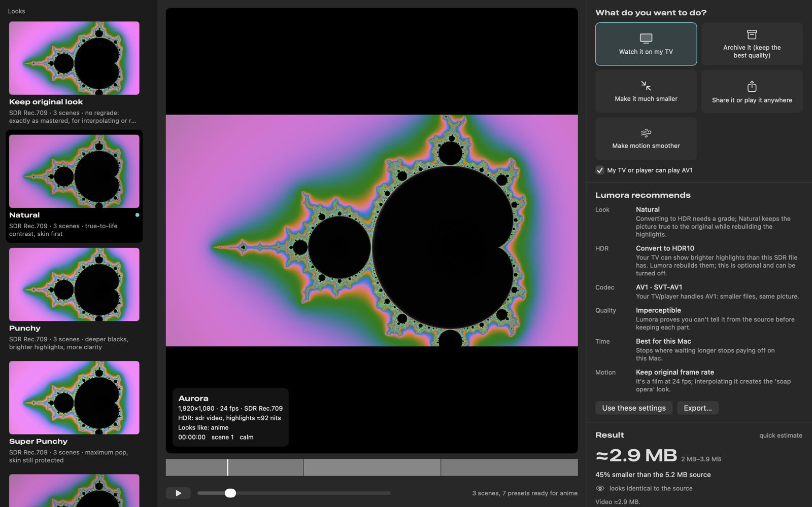
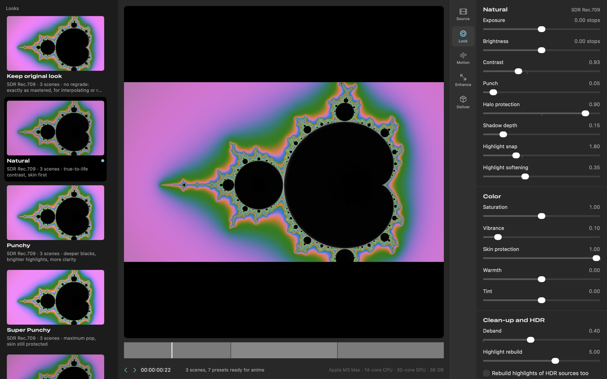
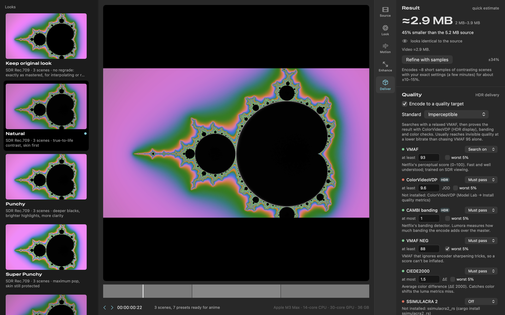
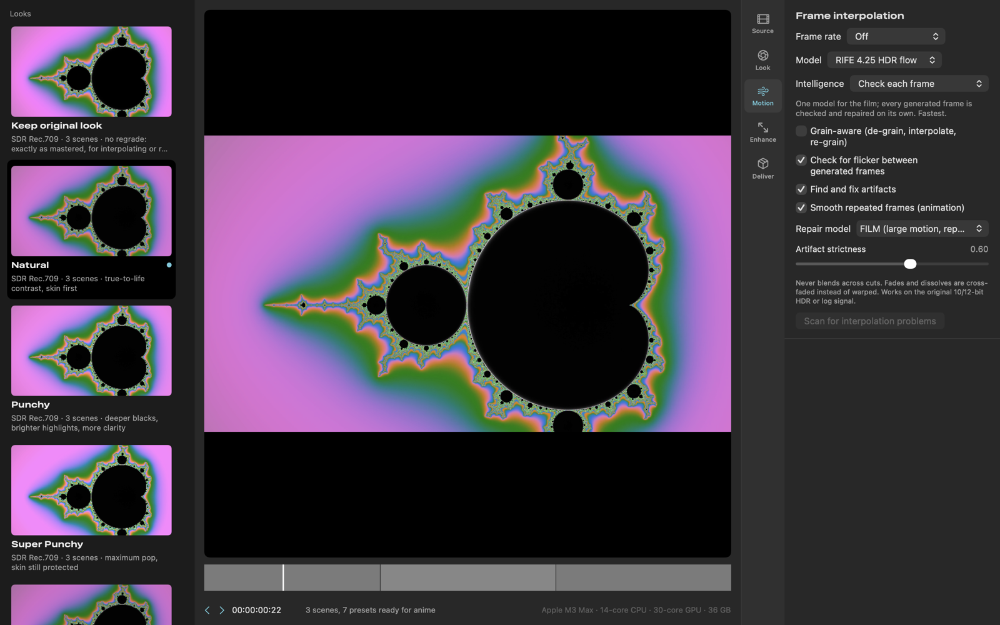
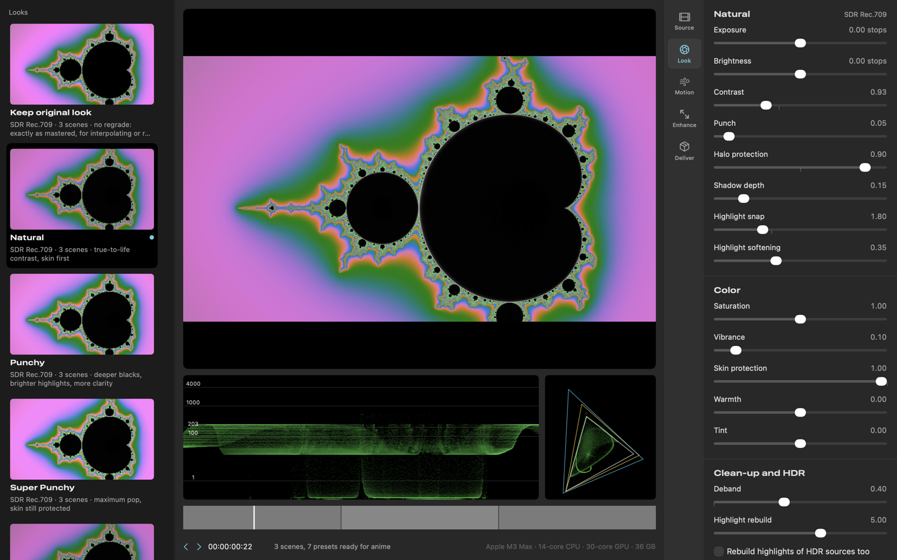
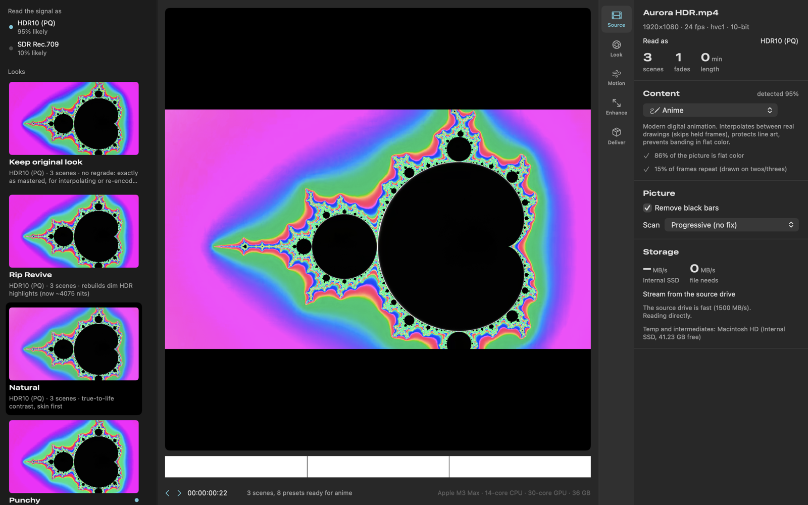
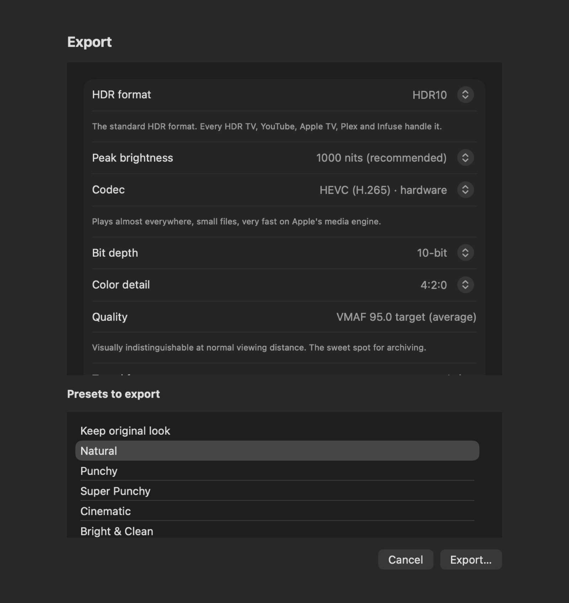
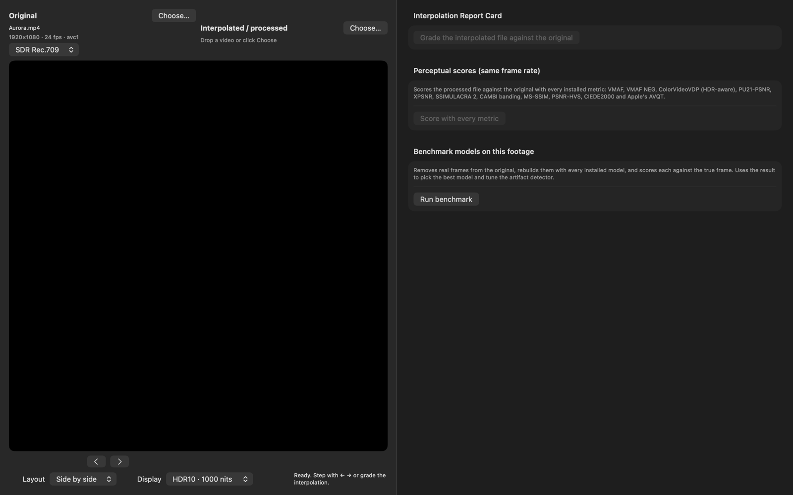
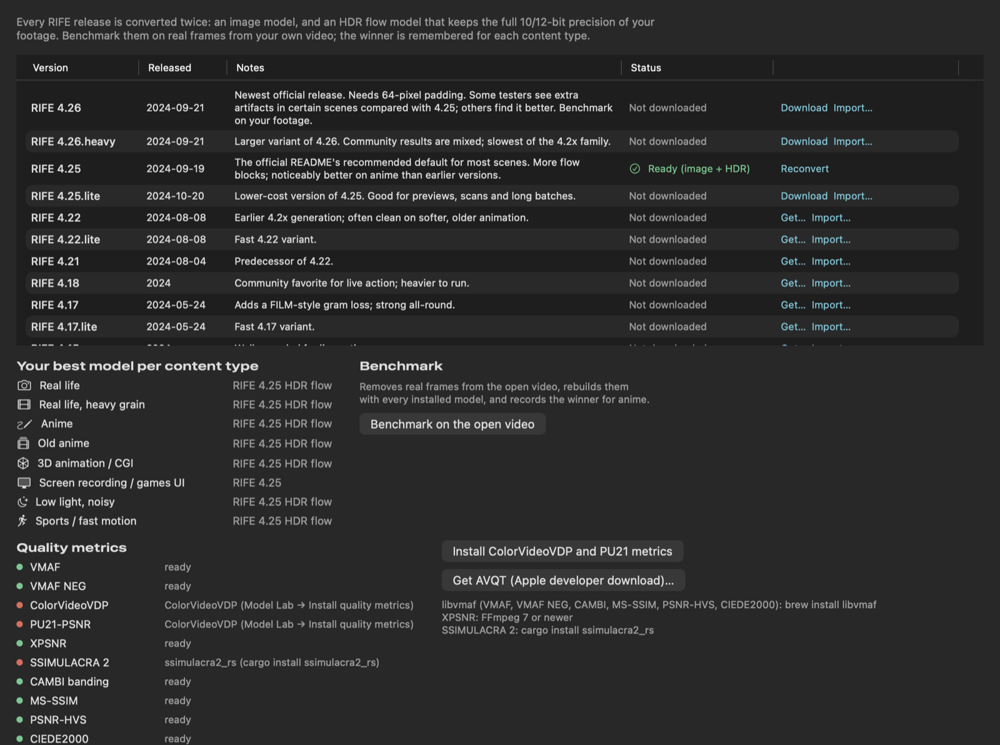

# Lumora

**Grade, convert and rebuild video between SDR and HDR on a Mac.** Lumora is a native macOS app (Swift, SwiftUI,
Metal, AVFoundation and VideoToolbox) that:

- turns SDR, HDR, camera log and RAW footage into natural or punchy **HDR10, HLG, Dolby Vision or SDR**
- converts **HDR → SDR**, **SDR → HDR** and **HDR → HDR** through one color-managed engine
- exports **10-bit and 12-bit HEVC, ProRes, AV1, H.266/VVC and AV2**
- raises frame rates with **RIFE-class interpolation**, then finds and repairs bad generated frames
- encodes to a **quality target** (VMAF plus HDR-aware checks) instead of guessing a bitrate
- explains every recommendation **in plain English**

It opens in a **Simple mode**: drop a file, say what you want ("watch it on my TV", "make it much smaller"…), and
Lumora picks the settings and tells you why. **Pro mode** exposes every control.



**Website and full documentation:** [info-moed.github.io/Lumora](https://info-moed.github.io/Lumora/)

> **Project status:** builds and runs on macOS 27 / Xcode 27. The core pipeline is verified end to end by automated
> tests; several advanced features are written but not yet verified. See [Project status](#project-status) before
> relying on any one feature.

---

## Contents

- [Screenshots](#screenshots)
- [Who this is for](#who-this-is-for)
- [Requirements](#requirements)
- [Quick start](#quick-start)
- [Documentation](#documentation)
- [Project status](#project-status)
- [How it works, in one paragraph](#how-it-works-in-one-paragraph)
- [Repository layout](#repository-layout)
- [Contributing](#contributing)
- [License and legal](#license-and-legal)

---

## Screenshots

| | |
|---|---|
| [](docs/images/07-pro-look.png) **Pro mode, Look:** every grade control, live on the HDR preview. | [](docs/images/10-pro-deliver.png) **Deliver:** format, quality target, time budget, size forecast and packaging. |
| [](docs/images/08-pro-motion.png) **Motion:** frame interpolation with per-frame checks and repair. | [](docs/images/11-pro-scopes.png) **Scopes:** PQ waveform with nit markers and a CIE plot. |
| [](docs/images/12-pro-hdr-source.png) **HDR sources:** read, measured and explained. | [](docs/images/14-export.png) **Export:** several looks at once, any codec. |
| [](docs/images/16-compare.png) **Compare:** original vs interpolated, side by side. | [](docs/images/17-model-lab.png) **Model Lab:** convert and benchmark RIFE models. |

More in the [User guide](docs/user-guide.md). All screenshots are regenerated from the real app with
`scripts/screenshots.sh`, using original generated footage.

---

## Who this is for

| You are… | Start here |
|---|---|
| **New to Macs, Terminal or HDR video** | [Getting started](docs/getting-started.md) walks through every step, from installing Xcode to your first converted file. [HDR and video basics](docs/hdr-basics.md) explains the vocabulary. |
| **Comfortable with apps, want to use Lumora well** | [User guide](docs/user-guide.md): Simple mode, every Pro tab, the Tools menu, windows and settings. |
| **Comfortable in Terminal** | [Building from source](docs/building.md) and the [Command-line guide](docs/command-line.md): `xcodebuild`, tests, `defaults` keys, tool overrides, logs, encoder recipes, model conversion, verifying output. |
| **Want to change the code** | [Architecture](docs/architecture.md) and [CONTRIBUTING.md](CONTRIBUTING.md). |
| **Something isn't working** | [Troubleshooting](docs/troubleshooting.md). |

---

## Requirements

| | Required | Notes |
|---|---|---|
| Mac | Apple silicon (M1 or later) | Intel Macs are not supported. Tuned for M5 / M5 Pro / M5 Max; tested on an M3 Max. |
| macOS | **27.0 or later** | The deployment target is 27.0. |
| Xcode | **27 or later** | Free from the Mac App Store. Only needed to build. |
| [XcodeGen](https://formulae.brew.sh/formula/xcodegen) | any recent | `brew install xcodegen`. Generates the Xcode project from `project.yml`. |
| [FFmpeg](https://formulae.brew.sh/formula/ffmpeg) | recommended | `brew install ffmpeg`. Reads files AVFoundation can't (MKV and more), joins segments, carries audio/subtitles. |
| Software encoders | optional | Only for AV1, VVC, AV2 and 12-bit HEVC: [`svt-av1`](https://formulae.brew.sh/formula/svt-av1), [`aom`](https://formulae.brew.sh/formula/aom), [`x265`](https://formulae.brew.sh/formula/x265), [`vvenc`](https://formulae.brew.sh/formula/vvenc). HDR metadata tools: [`dovi_tool`](https://formulae.brew.sh/formula/dovi_tool), [`hdr10plus_tool`](https://formulae.brew.sh/formula/hdr10plus_tool), [`gpac`](https://formulae.brew.sh/formula/gpac), [`mkvtoolnix`](https://formulae.brew.sh/formula/mkvtoolnix). Quality metrics: [`libvmaf`](https://formulae.brew.sh/formula/libvmaf). See [Getting started → encoders](docs/getting-started.md#step-5-optional-install-the-extra-encoders). |

Hardware HEVC and ProRes exports need nothing beyond macOS.

---

## Quick start

There is no pre-built download yet, so you build Lumora yourself. It takes about five minutes the first time.
Complete beginners: follow [Getting started](docs/getting-started.md) instead. It explains every line below.

```bash
brew install xcodegen ffmpeg
```

```bash
git clone https://github.com/info-moed/Lumora.git
```

```bash
cd Lumora && xcodegen
```

```bash
xcodebuild -project Lumora.xcodeproj -scheme Lumora -configuration Release -derivedDataPath build/DerivedData CODE_SIGN_IDENTITY=- build
```

```bash
open build/DerivedData/Build/Products/Release/Lumora.app
```

Then drop a video onto the window.

Prefer Xcode? After `xcodegen`, run `open Lumora.xcodeproj` and press **⌘R**.

---

## Documentation

| Guide | What's in it |
|---|---|
| [Getting started](docs/getting-started.md) | Install everything, build, first launch, your first conversion. Assumes no prior knowledge. |
| [HDR and video basics](docs/hdr-basics.md) | SDR vs HDR, nits, PQ and HLG, bit depth, chroma, codecs and containers, Dolby Vision profiles. |
| [User guide](docs/user-guide.md) | Simple mode, Pro mode tab by tab, the toolbar and Tools menu, every window, settings, shortcuts. |
| [Encoding settings](docs/encoding/index.md) | Every option of SVT-AV1, x265, VVenC, libaom, AVM and VideoToolbox, plus the HDR metadata tools: values, defaults, effects, HDR relevance and sourced recommendations by content type, checked against the installed encoders. Starts with a guide to choosing settings. |
| [Feature reference](docs/features.md) | Deep dive on every feature and the reasoning behind it: grading pipeline, codecs, quality metrics, interpolation, grain, storage, packaging. |
| [Building from source](docs/building.md) | XcodeGen, `xcodebuild`, Debug vs Release, signing and notarization, bundling helper tools, running the tests. |
| [Command-line guide](docs/command-line.md) | Everything you can drive or inspect from Terminal: settings keys, tool overrides, logs, scratch and data folders, encoder recipes, model conversion, checking output files. |
| [Architecture](docs/architecture.md) | How the code is organized, the frame pipeline, concurrency, Metal kernels, and how to extend it. |
| [Troubleshooting](docs/troubleshooting.md) | Common problems and their fixes. |
| [COMPARISON.md](COMPARISON.md) | Feature-by-feature comparison with other tools. |
| [CHANGELOG.md](CHANGELOG.md) | What changed in each version. |

---

## Project status

Lumora's source was written as a complete design first and compiled later; 0.11.1 was the first version that built.
Since then every area has been tested end to end. "Verified" means an automated test runs it for real (actual files,
the actual GPU and encoders) and checks the result with independent tools (ffprobe, dovi_tool, hdr10plus_tool,
metrics against ground truth). **320 automated tests pass** on macOS 27.3 with Xcode 27 (Apple M3 Max), and CI runs
them on every push.

**Verified**

| Area | What's checked |
|---|---|
| Every codec × bit depth × chroma × HDR format | 102 real exports (hardware HEVC, ProRes 422 HQ/4444 XQ, SVT-AV1, libaom, x265 12-bit, VVenC) from SDR and HDR10 sources: codec, profile, bit depth, chroma, color tags, frame count, audio, exposure, HDR10 static metadata; unsupported combinations refused with a clear reason. |
| HDR10+ and Dolby Vision | HDR10+ (hardware HEVC, x265) and Dolby Vision 8.1 (hardware HEVC, x265) and 8.4 (hardware HEVC) verified with `hdr10plus_tool` and `dovi_tool`: one RPU / metadata entry per frame, correct profile, MP4 and MKV. A film's original Dolby Vision is retimed through interpolation and black-bar cropping. |
| Ingest and analysis | MOV, MP4, MKV, WebM, AVI, Y4M, TS; H.264, HEVC, ProRes, AV1, VP9, MPEG-2; SDR, HDR10, HLG; interlaced, telecined, anamorphic, VFR; letterbox and pillarbox detection; cuts, fades and repeated frames; content types. |
| Grading | Every look to SDR, HDR10 (1000/2000/4000 nits) and HLG; every control at its extremes; LUT export (matches Lumora's own render through FFmpeg `lut3d`); HDR stills (HEIC, AVIF); presets; reference matching; MetalFX upscaling. |
| Frame interpolation | RIFE 4.25 converted to Core ML through Model Lab (image and HDR flow models) and run in the real pipeline: +11 to +12 dB over plain blending when rebuilding real frames. Exact frame timing for every mode (2×–8×, 60/59.94, slow motion); never across a cut. |
| Artifact checker | Measured against *Big Buck Bunny*'s native 60 fps render on held-out footage: makes 0.36% of frames worse (by at most 0.16 dB), where the previous design made 33–83% worse; catches 88–96% of missed shot changes. Details in the [feature reference](docs/features.md#interpolation-models). |
| Quality targets and metrics | Encoding to a VMAF target (HEVC, AV1) with dip repair; VMAF, VMAF NEG, XPSNR, CAMBI, MS-SSIM, PSNR-HVS, CIEDE2000; size forecasts vs actual; encoder calibration on this Mac. |
| Perceptual metrics | ColorVideoVDP and PU21-PSNR (installed by Model Lab) and SSIMULACRA 2 rank identical > CRF 20 > heavy on real SDR and HDR10 footage (JOD 10.00 / 9.78 / 8.66 on PQ, scored on the HDR display model). In real Imperceptible exports the gates run on every chunk and raise quality when they fail: SSIMULACRA 2 took an SDR chunk from 72 to 88, a stricter ColorVideoVDP gate took an HDR10 chunk from 9.67 to 9.86 JOD. Cost: about 16–22 s per check on a 2-second 720p chunk ([details](docs/features.md#quality-metrics-why-not-just-vmaf)). |
| Encoder presets | SVT-AV1 presets tuned per content type from measurements on *Tears of Steel* and *Big Buck Bunny*: 10.5% smaller at equal quality on average, up to 45% on low-light footage ([results](docs/encoding/tuning-svtav1.md)). |
| Packaging and batches | Plex/Infuse naming, metadata policies, track selection, Dolby Digital Plus compatibility tracks, chapters, every appendix (NFO, checksums, settings…), verification, batch queue resume after interruption, run rules, webhooks, archive verification. |
| Robustness and security | Corrupt, truncated and hostile files fail cleanly; hostile names and paths; cancellation leaves nothing behind; 17 security tests (see [SECURITY.md](SECURITY.md)). |
| User interface | Every window and sheet built and drawn with a video loaded (see the screenshots, generated from the real app); app flows driven end to end; Simple mode at the minimum window size. |
| Dependencies | Every encoder flag Lumora uses is accepted by the installed encoders, and the [encoder settings reference](docs/encoding/index.md) matches their `--help` (`scripts/deps.sh verify`). |

**Not verified yet, and why**

- **On a real screen:** the HDR (EDR) preview and the live window. Tests run headless, and the GPU preview layer can't
  be captured offscreen (its frames are checked directly on the GPU instead).
- **AV2 (AVM):** the reference encoder isn't installed; only its clean "not installed" message is tested.
- **Hardware or software not available here:** vendor RAW SDKs (BRAW, R3D, ARRIRAW, Canon RAW); real camera Bayer DNGs
  and Apple Log footage; hard-drive sources; AirPlay playback to an Apple TV; Mac notifications; TMDB lookups (need a key).
- **Models and metrics not installed:** FILM, IFRNet and GMFSS (no converters yet), Real-ESRGAN, and AVQT (an Apple
  developer download behind a sign-in). Their "missing" paths are tested.
- **Optimize for this Mac:** deliberately not run on the development machine yet.
- **Preset tuning for x265, VVenC and libaom:** in progress (SVT-AV1 is done).

Found something that works, or doesn't? Please [open an issue](https://github.com/info-moed/Lumora/issues). Reports
from other Macs are especially useful.

---

## How it works, in one paragraph

Lumora decodes each frame (with VideoToolbox, Core Image RAW or FFmpeg) and wraps it as a Metal texture with no
copies. One GPU grading kernel then runs every step: decode the transfer curve to scene light, convert to linear
BT.2020, white balance and exposure, local-contrast "punch", a hue-preserving tone curve, film-like highlight
roll-off, Oklab color, gamut compression and the output encoding (PQ, HLG or BT.1886). Preview, analysis and export
share that one code path, so what you see is what you get. Frames stream through bounded in-memory pipelines into
the hardware encoders or into command-line encoders through pipes. Nothing is extracted to disk, and nothing is
written next to your source files. Details: [Architecture](docs/architecture.md).

---

## Repository layout

```
Lumora/
├── Lumora/                 the app
│   ├── App/                entry point and the main app model
│   ├── Core/               engine: ingest, color, render, interpolation, quality, export, workflow…
│   ├── Shaders/            Grade.metal (all GPU kernels) and ShaderTypes.h (shared with Swift)
│   ├── UI/                 SwiftUI views
│   └── Resources/          encoder recipes, model catalogs, metric helper script
├── Tests/LumoraTests/      unit, end-to-end and UI smoke tests
├── scripts/                encoder installer, tool bundler, Core ML model converters
├── docs/                   all documentation
├── project.yml             XcodeGen project definition (the .xcodeproj is generated, not committed)
├── CHANGELOG.md  COMPARISON.md  CONTRIBUTING.md  LICENSE
```

---

## Contributing

Bug reports, test results on other Macs and pull requests are welcome. Read [CONTRIBUTING.md](CONTRIBUTING.md)
first; it covers building, the test suite, code style and how to report a problem usefully.

---

## License and legal

Lumora is released under the [MIT license](LICENSE).

- **Your files only.** Lumora works on video files you already have. It does not decrypt discs.
- **Helper tools keep their own licenses.** FFmpeg builds with GPL parts, and x265, are GPL. Lumora runs them as
  separate programs that you install yourself. SVT-AV1, libaom, VVenC and AVM use BSD-style licenses with
  AOMedia/Fraunhofer patent terms.
- **Models keep their own licenses.** RIFE (MIT), FILM (Apache-2.0), Real-ESRGAN (BSD-3-Clause); check IFRNet and
  GMFSS before redistributing.
- **Dolby Vision and HDR10+** metadata is generated with open tools. Using the logos, or certified delivery,
  requires licenses from Dolby and HDR10+ Technologies.
- **Independent work.** Lumora is not affiliated with any other video tool it is compared with, and contains none of
  their code, presets, models or branding.
