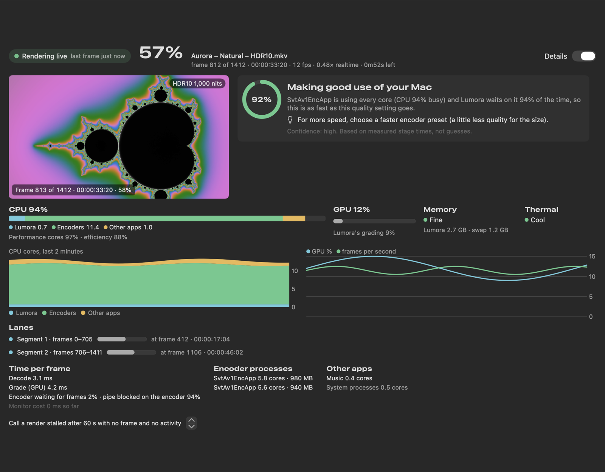

# Feature reference

Everything Lumora does, where it lives in the code, and the reasoning behind each choice. New to Lumora? Start with
[Getting started](getting-started.md). Want to know what has actually been tested? See
[Project status](https://github.com/info-moed/Lumora/blob/main/README.md#project-status).

Some sections describe features that are written but not yet verified end to end; the status table in the README is
the source of truth. Items marked **VERIFY** depend on details that couldn't be confirmed without specific hardware,
SDKs or tool versions.

Related: [COMPARISON.md](https://github.com/info-moed/Lumora/blob/main/COMPARISON.md) compares Lumora with other tools feature by feature, and
[CHANGELOG.md](https://github.com/info-moed/Lumora/blob/main/CHANGELOG.md) lists everything in each version.

---

## What it does

| Request | Where it lives |
|---|---|
| Mac-native, from scratch | Swift, SwiftUI and Metal throughout. No cross-platform layers. |
| macOS 27 + M5 / M5 Pro / M5 Max | `ChipProfile.swift`: detects chip, GPU cores, encode engines and memory, then sizes every stage. See **M5** below. |
| HEVC, AV1, H.266/VVC, AV2 (+ ProRes) | `Codec.swift`, `ExportEngine.swift`, `encoders.json` |
| 10-bit and 12-bit only, minimum 4:2:0, accepts 8-bit input | `Codec.bitDepths` / `chromaFormats`. The 12-bit path decodes and grades in 32-bit float. |
| Any RAW format | ProRes RAW (AVFoundation); DNG/CinemaDNG and ~600 camera stills formats (Core Image RAW, scene-linear); BRAW, R3D, ARRIRAW, Canon RAW (vendor SDK plug-ins); everything else via FFmpeg |
| Auto presets from Apple Log / Apple Log 2 | `SourceInspector` reads Apple's log tag, camera model and the picture itself. `AutoPresetEngine` builds presets for each likely profile. |
| Detect and make multiple presets | Natural, Punchy, Super Punchy, Cinematic, Bright & Clean, Moody, and Rip Revive for HDR sources. Each is adapted to the footage, with per-scene exposure. |
| Natural and super punchy | `Grade.metal`: hue-preserving tone curve, local-contrast "punch", Oklab vibrance with skin protection, film-like highlight roll-off |
| LUTs | `LUTExporter`: 33- or 65-point `.cube` of any preset, from any source profile to any target |
| HDR→SDR, SDR→HDR, HDR→HDR | One engine. PQ/HLG/Dolby Vision sources are decoded to scene light, then tone-mapped to any target. SDR sources get highlight reconstruction. |
| All HDR formats | HDR10, HDR10+ (beta), HLG, Dolby Vision 8.1, Dolby Vision 8.4. Inputs include Dolby Vision 5/8 via AVFoundation. |
| Plain-English advice | `FormatAdvisor`: pick where the video is going, get a recommendation, the reasons, and what to watch out for |
| Full interpolation (RIFE and others) | `Core/Interpolation`: RIFE, FILM, IFRNet, GMFSS via Core ML; 2×/4×, exact 60/59.94/120 fps, slow motion |
| Find and fix bad interpolation, only where needed | `ArtifactScorer`: a learned, reference-free per-tile scorer (trained against a native 60 fps film) switches only tiles it predicts are broken to a better candidate, with a per-frame risk budget; holds the nearest original at shot changes the analyzer missed; never warps across cuts; fades and dissolves are blended |
| Works with HDR / 10-bit | Models run on the encoded log/PQ/HLG signal in fp16 tensors (no 8-bit round trip). Original frames are never touched. |
| UHD HDR reference library | `HDRLibrary` + `LibraryView`: schema, your own entries, and sync from a community JSON URL |
| Fix your own rips | HDR Report Card (plain-English verdict on any file), then the Rip Revive preset, then HEVC/AV1 HDR10 or Dolby Vision 8.1, keeping all audio and subtitles |

---

## Grading pipeline (one code path for preview, analysis and export)

Every pixel goes through these steps, in order:

1. **Decode to scene light.** The encoded signal is decoded with Apple Log, S-Log3, LogC3, LogC4, V-Log, BT.1886, sRGB, PQ, HLG or linear RAW.
2. **Convert to the working space**, linear BT.2020.
3. **White balance and exposure**, including per-scene auto exposure.
4. **Punch.** Local contrast is applied in log-luminance. The radius scales with the image, and a soft clamp prevents halos.
5. **Tone curve.** Contrast is set around mid gray, a generalized Reinhard shoulder rolls off to the target peak, and a toe adds shadow density. The curve uses a hue-preserving norm.
6. **Highlight desaturation** near peak, like film.
7. **Color.** Oklab saturation plus vibrance, with skin hues held back.
8. **Output.** Conversion to the output gamut with soft gamut compression, then PQ, HLG (BT.2100 inverse OOTF) or BT.1886 encoding.

The preview writes PQ or HLG straight into an EDR `CAMetalLayer` with `CAEDRMetadata`. On a MacBook Pro XDR screen you see the actual HDR output. **Before/After** shows the ungraded signal beside the grade.

**Rip Revive** is for dim HDR masters. It decodes PQ, expands only the light above about 100 nits up to the source's measured peak, then re-tone-maps to the new target peak. Mid-tones keep the colorist's original intent, and highlights gain real punch.

---

## M5 and macOS 27 specifics

- **Media engine.**
  - Decode: hardware for H.264, HEVC, ProRes, ProRes RAW and AV1.
  - Encode: hardware for HEVC Main10 and ProRes.
  - The M5 Max has **two** video encode engines and two ProRes engines. Lumora splits hardware exports into one segment per engine. Segments are snapped to scene cuts so there are no seams.
- **CPU.** The 18-core M5 Pro/Max (6 super + 12 performance cores) runs the software encoders as parallel segment instances:
  - SVT-AV1: about 2 instances
  - VVenC: about 4 instances
  - AVM: many instances, because it is mostly single-threaded
- **GPU Neural Accelerators.** Each M5 GPU core has one. Interpolation models run through Core ML with `computeUnits = .all` and fp16 tensors, so Core ML can schedule layers onto the GPU Neural Accelerators or the 16-core Neural Engine. A future step is moving the hottest layers to Metal 4.1 TensorOps (macOS 27 adds FP8/MX formats).
- **Unified memory.** Decoded frames are wrapped as Metal textures with no copies (`CVMetalTextureCache`). Core ML writes its output straight into Metal-visible buffers (`outputBackings`). The software encoders read planar frames the GPU wrote, also without copies.
- **Analysis resolution** scales with the chip tier: 960 px on Pro/Max, 640 px on base chips.
- **macOS 27.** The deployment target is 27.0, arm64 only. Xcode 27 applies Liquid Glass automatically.

---

## Codecs, bit depth, chroma

| Codec | Engine | Bit depth | Chroma | HDR formats |
|---|---|---|---|---|
| HEVC | VideoToolbox (hardware) | 10 | 4:2:0 | HDR10, HLG, HDR10+, DV 8.1, DV 8.4 |
| ProRes 422 HQ | VideoToolbox (hardware) | 10 | 4:2:2 | HDR10, HLG |
| ProRes 4444 XQ | VideoToolbox (hardware) | 12 | 4:4:4 | HDR10, HLG |
| AV1 | SVT-AV1 | 10 | 4:2:0 | HDR10, HLG |
| AV1 Pro | libaom | 10/12 | 4:2:0/4:2:2/4:4:4 | HDR10, HLG |
| H.266 / VVC | VVenC | 10 | 4:2:0 | HDR10, HLG |
| AV2 (experimental) | AVM reference | 10 | 4:2:0/4:2:2/4:4:4 | HDR10, HLG |
| HEVC Main 12 | x265 | 10/12 | 4:2:0/4:2:2/4:4:4 | HDR10, HLG, HDR10+ |

H.264 was dropped because Apple's hardware encoder for it is 8-bit only.

AV1, VVC and AV2 are always software encodes: the M5 media engine decodes AV1 but encodes none of these three.

Notes from the codec test matrix (`CampaignCodecTests`):

- aomenc (libaom 3.15) refuses 12-bit 4:2:2 and 4:4:4 when `--profile=2` is given explicitly, so for those Lumora passes profile 0 and aomenc raises it to the Professional profile itself ([libaom tuning](encoding/tuning-aomenc.md)).
- aomenc can't write HDR10 static metadata into the stream, so for `.mkv` output Lumora adds MaxCLL/MaxFALL and the mastering display to the Matroska color metadata with mkvmerge.
- x265 and VVenC write raw streams without timestamps; Lumora wraps them with MP4Box (or mkvmerge for HEVC) before muxing.
- ProRes 4444 XQ is always coded at 12 bits; choosing 10-bit only lowers the grading precision.

### AV2 (AVM)

AV2 is an experimental, raw `.obu` export (video only, no audio), for two reasons:

- The AV2 specification was finalized in mid-2026, but only the slow reference encoder exists.
- There is no MP4 or Matroska binding for AV2 yet, and FFmpeg can't read it.

Lumora drives `avmenc` from AVM `research-v15.0.0` (the AV2 v1.0 reference), which
`scripts/install-encoders.sh` builds from the official repository into `~/.local/bin` together with the `avmdec`
decoder. What an AV2 export does, and how it was checked (`AV2ExportTests`, every export decoded with `avmdec`):

- **Color signaling.** SDR is written as BT.709, HDR10 as BT.2020 + PQ and HLG as BT.2020 + HLG (`hlg`; AVM rejects
  FFmpeg's `arib-std-b67` name), limited range, chroma siting "center" (how Lumora averages chroma). After each export
  Lumora reads the stream's content interpretation OBU back (`AV2Stream`) and fails the export if the signaling is
  wrong. avmenc can't write HDR10 mastering-display or MaxCLL metadata, so PQ files carry the color description only.
- **Bit depth and chroma.** 10-bit only, in 4:2:0, 4:2:2 and 4:4:4 (AVM picks profile 0, 3 or 4 from the input).
  AV2 v1.0 has no 12-bit profile: AVM's 12-bit mode is a test-only build option that no conforming decoder plays, so
  Lumora doesn't offer it.
- **One pass.** AVM has no two-pass mode; Lumora passes `--passes=1` explicitly (libaom's two-pass default writes an
  empty file when fed through a pipe, and Lumora always pipes frames in).
- **Film grain.** Film texture and the measured-grain option work on AV2. AVM reads its own `filmgrn2` table format,
  which differs from AV1's `filmgrn1` (13 parameters, with a grain block size), so Lumora writes `filmgrn2` for AV2.
  An AV1 table is silently ignored by AVM: it encodes with no grain at all. Measured: a table asking for σ 4.06 code
  values decodes to σ 4.12, and `avmdec --skip-film-grain` returns the clean picture.
- **Long exports** run as several segments in parallel and are joined by concatenating their OBU streams (each starts
  with its own sequence header and key frame); `avmdec` plays the joined stream through.

Measured results (256×144 test clips, speed 6, quality slider at the middle, `--qp 140`), decoded and compared frame
by frame with the same render exported as ProRes 4444 XQ:

| Export | Frames | Luma PSNR vs ProRes (mean / worst) | Signaling read back |
|---|---|---|---|
| SDR 4:2:0 | 12 of 12 | 49.1 / 39.3 dB | BT.709 (description 1) |
| HDR10 4:2:0 | 12 of 12 | 48.0 / 39.3 dB | BT.2020 PQ (description 2) |
| HLG 4:2:0 | 12 of 12 | 49.3 / 38.8 dB | BT.2020 HLG (description 3) |
| SDR 4:2:2 | 12 of 12 | 49.0 / 39.5 dB | BT.709 |
| HDR10 4:4:4 | 12 of 12 | 48.1 / 39.5 dB | BT.2020 PQ |

**Speed: plan on minutes per frame.** AVM is a reference encoder, built to show what the codec can do, not to be
fast. Measured on a shared M-series Mac (other jobs running, AVM at low priority):

| Clip | Setting | Speed |
|---|---|---|
| 1280×534 live action, 12 frames | speed 5, 4 threads | 0.0066 fps (1,808 s; about 2.5 min per frame), 39.6 dB PSNR at `--qp 135` |
| 320×136 live action, 24 frames | speed 6, 2 threads | 0.036 fps (664 s) |
| 256×144 test pattern, 12 frames | speed 6, whole export | 0.25–0.40 fps (30–48 s) |
| 320×136 live action, 12 frames, one thread | speed 6 / 5 / 4 | 37.5 / 39.2 / 51.1 CPU-seconds per frame |

Speed 5 and 4 buy little: at equal PSNR (two-point BD-rate over `--qp` 120 and 160 on that clip), speed 5 files are
0.4% smaller for 4% more time and speed 4 files 4% smaller for 36% more time.

At those rates one minute of 24 fps 720p video takes roughly two to three days on one encoder instance, and 1080p
about twice that. Lumora runs several instances in parallel on long exports (one per two cores), which helps, but
AV2 stays practical only for short clips and experiments. Speed 6 is the default because it is AVM's fastest
distinct setting (7 to 9 behave like 6); the planner moves to speed 5 or 4 only when the export still fits its time
limit.

Not available with AV2: quality targets (VMAF scoring needs a decoder Lumora can read frames from), slow motion, and
audio (there is no container to put it in).

---

## Encoding to a VMAF target

Turn on **Deliver → Quality target**, pick a score, and Lumora encodes each scene-aligned chunk at the cheapest setting that reaches it:

1. The chunk is rendered once (decode, interpolate, upscale, grade) into RAM. It is not written to disk.
2. The chunk is encoded, decoded by FFmpeg, and scored by libvmaf, streamed through named pipes.
3. A search refines the setting in 2–4 trials, guided by a predictor that learns from your past encodes.
4. Any 1-second stretch that still dips below target is re-encoded on its own.

**Targets in plain terms:**

| VMAF | What it means |
|---|---|
| 97+ | Practically identical |
| 94–97 | Visually indistinguishable at normal distance |
| 90–94 | Excellent |
| Below 90 | Streaming quality |

**About HDR.** VMAF was trained on SDR viewing. Lumora scores the PQ/HLG-coded 10-bit signal, which measures compression loss consistently, but VMAF is not a calibrated HDR scale. Use targets as a consistent safety margin, and confirm by eye on an HDR display (the Compare window helps).

**What it compares against.** The reference is Lumora's lossless render of the graded, interpolated picture, not the original file. Interpolated frames have no original to compare to; their quality is judged separately by the Interpolation Report Card.

Install VMAF with `brew install libvmaf`; it provides the `vmaf` command. FFmpeg builds that include `libvmaf` are also used if present.

## Finished files

Every export is packaged automatically:
- **Name:** Plex/Infuse naming, a custom pattern, or your own name.
- **Metadata:** keep it, remove personal details, or remove everything, plus your own fields (optional online lookup).
- **Tracks:** chosen audio and subtitles, an optional Dolby Digital Plus compatibility track, chapters.
- **Appendices:** settings file, quality report, checksum, NFO, poster, chapters, HDR report, log.
- **Verification:** the finished file is decoded end to end.

Long batches survive restarts, follow your hours, pause on battery or heat, and notify your Mac or phone. **Tools → Verify an archive folder** re-checks checksums on your archive drive.

## Dolby Vision and screens

- **Original Dolby Vision kept and retimed** when the look is unchanged and the output is HEVC. That includes the colorist's trims, through interpolation and cropping. Otherwise Lumora writes new metadata and says why.
- **Grade for a screen** reads this Mac's display (reference modes exactly; XDR panels from Apple's specs; other HDR screens estimated) or targets phones, OLED and mini-LED TVs. It grades highlights to the real peak and guards against TV brightness limiters. **Make it pop** uses the screen's full headroom.
- **Future-proof export:** a 4000-nit 12-bit master plus a Dolby Vision viewing copy.

## Simple mode

Lumora opens in **Simple mode**:

1. Drop a file. Lumora reads every frame (scenes, HDR quality, grain, motion), with a live, playable preview and an info panel on the picture.
2. Pick what you want: watch on TV, archive, make smaller, share, or make motion smoother.
3. Read the recommendations, each with a plain-English reason, and click **Use these settings**.

**Busiest moments → Test smoothing** shows the original next to the interpolated version of the film's hardest motion before you commit. **Pro mode** exposes every control.

## Interpolation intelligence

| Level | What it does | Speed |
|---|---|---|
| Check each frame | One model for the film; every generated frame is scored tile by tile and repaired only where a fix is predicted to help | Fastest |
| Route a model per scene | Likely models are rebuilt against real frames removed from each scene; each scene uses its winner | Moderate |
| Exhaustive until confident | Every installed model is tested on every scene until the winner is proven at your confidence (97% default); uncertain or hard scenes are generated twice per frame and the cleaner frame is kept | Very slow, maximum quality |

The **pain-point map** (top row of the scene strip, plus the Motion tab) shows each scene's model, confidence and expected repair rate. If a finished export still has flagged frames, **Compare → Repair these frames** fixes just those chunks in place.

## Grain

- **Grain-aware interpolation:** de-grain → interpolate → re-grain with real grain from the nearest frame.
- **Grain-blind artifact checks.**
- **Fair scoring with AV1 grain synthesis:** synthetic grain is stripped at decode and compared against a de-grained master.
- **Measured AV1 grain tables** built from the film's own grain.
- **Restore film texture** for grain-scrubbed transfers, at no bitrate cost.

The grain table scale constant is marked VERIFY. Tune the strength by eye on your TV.

## Optimize for this Mac

**Tools → Optimize for this Mac** tunes Lumora to the exact machine:

- GPU threadgroup shapes
- which compute units each neural model should use
- how many hardware encodes run in parallel
- how many CPU encoders keep every core busy
- memory budgets
- sustained (heat-soaked) speed

Levels: Quick (about 5 min), Thorough (about 30 min), and Burn-in (hours; also calibrates encoders and interpolation on your open film). Live gauges show CPU, GPU, memory and thermal state. Results are stored per machine model and OS version.

## Live render monitor

While an export renders, **Tools → Encode monitor** shows what is being made and how hard the Mac is working, and a
status pill in the toolbar (and a progress bar on the Dock icon) says whether it is alive.



**Live preview.** The frame each pipeline lane just graded, a few times a second, with frame number, timecode and
percent. HDR10 and HLG exports show in HDR on an HDR display (the same EDR setup as the main preview); SDR exports in
BT.709. The copy is a small (480 px) GPU scale encoded into the grade's own command buffer: no waiting and no CPU
readback, so the render never slows down for the preview. With **Details** on, a filmstrip shows the last five frames.
Parallel segments each show their position; quality-target trial encodes are labeled ("Chunk 12 · trial 3 (quality
search)").

**Utilization, once a second, with two minutes of history:**

| Reading | Source |
|---|---|
| CPU, per core and per cluster (performance and efficiency cores) | Host CPU ticks; the device tree names each CPU's cluster |
| Lumora, its encoders, other apps | Per-process CPU time for Lumora and every process it started, including helpers that start and exit between two readings (quality-search trials, metric calls: counted from what Lumora reaps); other apps = everything busy minus those two (exact, includes system processes) |
| The busiest other apps (names only) | Your own apps, grouped by app bundle; system and other users' processes show as "system processes" |
| GPU | The GPU's own device utilization, and the time Lumora's grade commands spend on it |
| Memory | The kernel's memory pressure level, swap use and growth, Lumora's footprint |
| Heat | The thermal state macOS reports |
| Speed | Frames per second, × realtime, time left |
| Media engine (hardware HEVC and ProRes) | Not measurable on macOS without admin tools. Lumora infers it from how long the hardware encoder makes frames wait, and says so |

Sampling costs about 0.3 ms of CPU per second (0.03% of one core, measured); the other-apps scan (3 to 7 ms) runs
every 5 s, only while the monitor is open or the Mac looks overloaded.

**"Making the most of your Mac?"** The verdict comes from measurement, not guesses. Each stage of the pipeline is
timed: decoding, upscaling, frame interpolation, GPU grading, how long the grader waits for frames, and how long the
writer is blocked by the encoder (or, for hardware encodes, how long the encoder input is not ready). The verdict,
in order of precedence:

| Verdict | When |
|---|---|
| Paused | Paused by you, a run rule, or the governor (memory, disk). No score. |
| The Mac is hot and slowing itself down | Thermal state serious or worse for 10 s; the speed drop against the first minute is shown. |
| Memory is tight | Memory pressure warning, or swap growing more than 100 MB a minute. |
| The drive is the limit / the disk is almost full | The encoder waits while writes run near the drive's measured speed, or free space is below the reserve. |
| Other apps are competing for the CPU | The Mac is at least 92% busy and other apps use a quarter of the cores or more while Lumora is CPU-limited. Scored as Lumora's share of the whole Mac, never shown green. |
| **Making good use of your Mac** | The encoder keeps Lumora waiting at least 70% of the time and the cores are saturated: as fast as this preset goes. Suggests a faster preset if you want speed. |
| Cores are sitting idle | The encoder is the limit but 80% or less of the CPU is busy. Suggests more parallel segments ("Optimize for this Mac measures the best count"; text only, it never starts the optimizer). |
| The quality search is the limit | Quality-target encodes: rendering waits for trial encodes and quality checks (after the last frame is rendered, the search is all that runs, and it is still measured). |
| Lumora is resting between frames | The encoder waits for frames because Lumora rests a quarter of the time or more (Lower priority, a hot Mac, a busy display GPU); the reason is named. |
| Decoding / interpolation / upscaling is the limit | The encoder waits for frames, the grader waits for the producer, and that stage takes most of the producer's time. |
| The GPU is the limit | The encoder waits for graded frames and the GPU is 80% or more busy. |
| Making good use of the media engine | Hardware encodes: the encoder input isn't ready at least 70% of the time. |
| Mixed: no single step dominates | Nothing above applies. |

"Saturated" is judged on what other apps leave free: measured on a Mac where other jobs kept about 10 of 14 cores
busy, an 8-second 720p libaom export (one segment, so 1.5 cores for aomenc) was reported as "Cores are sitting idle"
(Lumora used 43% of the cores left free), with the note that the clip was too short to split, rather than as a good
use of the Mac.

A verdict must win 5 seconds in a row (alarms 3) and stays at least 10 s, with exit thresholds 10 points below entry,
so it doesn't flicker. The first 15 seconds say "Measuring…". When the evidence is thin the wording changes to
"Probably…" or "Not sure yet". The score is the share of what is available to Lumora that it uses on the limiting
resource: CPU = (Lumora + its encoders) ÷ (cores − other apps); GPU = Lumora's GPU time ÷ (1 − other apps' GPU),
or the device total while Core ML upscaling or interpolation runs (their GPU time isn't attributed per process);
media engine = time the hardware encoder makes frames wait. When other apps compete for the CPU the score is
Lumora's share of the whole Mac instead: measured with libaom while other jobs kept 12.3 of 14 cores busy, the old
formula showed a green 99% while aomenc had 1.4 cores.

**Alive and rendering.** The status says **Rendering live**, **Paused: <reason>**, **Waiting on <stage>** (for
example "Waiting on x265 (finishing its last frames)"), **Finishing file: joining segments**, **Measuring HDR light
levels (40%)** or **Measuring film grain** (steps before the first frame), or **Stalled**, with the time since the
last finished frame. A step before the first frame is stalled only when its progress stops for 2 minutes (or the
stall time, if longer) with no other sign of life, so measuring a two-hour HDR film is never called stalled. A render is called stalled only when no frame has finished for longer than the
stall time (60 s by default, adjustable in the monitor's details, but at least 8× this run's 95th-percentile frame time) *and* there is no other
sign of life for 30 s: no encoder CPU, no GPU work, no files growing. A 90-second AV2 frame or a slow Real-ESRGAN
frame is therefore never called stalled.

**Never seizing up the Mac.**
- Encoders and other helper processes start niced (+5 for an export, +10 in a batch). Without admin rights niceness
  can only go up, so the default is mild; it costs nothing when the Mac is otherwise idle.
- Batches run at utility priority; a single export keeps user-initiated priority (utility threads were measured
  waking 46 ms late on a busy Mac).
- Memory pressure (kernel events and level): at a warning, quality-target encodes run half as many chunks at once
  and the filmstrip is dropped; at critical, work pauses at the next frame before macOS starts swapping, and resumes
  when memory recovers.
- Thermal serious: Lumora's helpers (encoders, metric tools) move to the background band, where they run on the
  efficiency cores at low clock, Lumora rests 20% of the time between frames, and runs one chunk fewer; all undone
  once the Mac cools (unless you chose Lower priority). Critical pauses (run rule).
- A probe commits a tiny GPU command (a 64 KB fill, which really runs on the GPU) on its own queue and times it to
  the GPU's own end timestamp, so a busy CPU can't read as a busy GPU; if the p90 of the last 30 readings is over
  8 ms (the display's frames would be waiting), Lumora paces its GPU work. Each export starts unpaced.
- The monitor measures the app's own responsiveness during the export (main-thread answer time, timer wake lateness,
  GPU wait) and puts it in the summary, with the idle baseline measured while the monitor is open or in the 20 s
  after each render (left out until there are enough idle readings).
- A memory pause re-reads the kernel's pressure level every second, so it ends once memory has recovered even
  between batch files, when nothing else is sampling.

**Load too high.** When other apps keep the CPU at least 95% busy with 40% of it theirs, memory pressure is high, swap
grows, or the Mac is hot, for 15 s in a row, a banner says so in plain words, names the three busiest other apps by
CPU and by memory, and offers **Pause**, **Lower priority** (encoders in the background band, Lumora resting half the
time; much slower on a busy Mac, and undone with **Normal priority**) or **Continue** (quiet for 10 minutes unless it
gets worse).

**Disk too full.** The export window estimates the space a job needs on every drive involved: the parallel segments,
the join, the container and HDR metadata passes (two more for Dolby Vision and HDR10+), quality-search trials, a
source copy and model downloads; plus the finished file again when the export folder is on another drive. It says
exactly how much to free ("needs about 38 GB on Macintosh HD, 22 GB free: free 21 GB (including a 5 GB margin)") and
offers **Clear Lumora caches…**, which lists only Lumora's own leftovers with their sizes (stale scratch job folders,
preview proxies, compiled models, model downloads, older staged source copies, unchecked) and never touches anything
else: the staged copy of the open source, or of anything a running export reads, is never listed. The space check
runs off the main thread, once the export settings stop changing. During the job, free space is
checked every 5 s; when the rest of the job would leave less than 2 GB plus 2% of the drive (at most 5 GB in all),
the render pauses cleanly at its next frame and continues on its own when space returns.

**After the export.** One summary line goes to the log (and so into the packaged report):

```
48 frames in 0m03s (17.9 fps, 0.75× realtime); bottleneck other apps (SvtAv1EncApp); score 6%; CPU Lumora 0.1,
encoders 0.8, other apps 13.1 cores (P 100%, E 100%); GPU 8% (Lumora 1%); pressure normal, swap +0 MB, thermal
nominal; per frame decode 12.9 ms, grade GPU 0.7 ms; encoder starved 85%, pipe blocked 15%; pauses 0, stalls 0;
UI main-thread p95 2 ms (baseline 0 ms); monitor cost 7 ms
```

and a small JSON file (file names only) to `~/Library/Application Support/Lumora/RenderSummaries/` for the "Last
export" card.

## Size forecast

**Deliver → Result** shows the answer before you encode: *"≈16 GB (14–18) · 73% smaller · looks identical · about 9 hr"*.

| Stage | How | Typical accuracy |
|---|---|---|
| Instant | Duration, resolution, frame rate, content type, codec, quality standard | ±30% |
| Refine with samples | ~8 short samples of contrasting scenes, encoded with your exact settings and checks, extrapolated scene by scene | ±10–15% |
| During the encode | Measured chunks, blended with the forecast | about ±5% after a quarter of the film |
| Over time | Every finished export corrects future forecasts for that codec and content type | Tightens with use |

Audio and subtitles are measured exactly from the source and added unchanged. **Tools → Estimate sizes for a folder…** gives archive-wide totals from metadata alone.

## Quality metrics: why not just VMAF

VMAF is fast and well understood, but it was trained on SDR viewing, misses banding and color shifts, and can be inflated by sharpening. Lumora combines several metrics, each doing what it's good at:

| Metric | What it catches | HDR | Speed | Source |
|---|---|---|---|---|
| ColorVideoVDP | Human-vision model: luminance, color and motion on a described display (JOD; 10 = identical) | Yes (PQ, HLG) | Slow | Model Lab → **Install quality metrics** (cvvdp 0.5.7) |
| PU21-PSNR | Fidelity in perceptually uniform HDR units | Yes | Medium | Same as above |
| XPSNR | Perceptually weighted error | — | Fast | FFmpeg 7+ |
| VMAF / VMAF NEG | Overall perceptual quality; NEG ignores sharpening | SDR-trained | Fast | libvmaf |
| CAMBI | Banding added by the encode | PQ-aware | Fast | libvmaf |
| MS-SSIM, PSNR-HVS | Structure and contrast-weighted error | — | Fast | libvmaf |
| CIEDE2000 | Color shifts | — | Fast | libvmaf |
| SSIMULACRA 2 | Psycho-visual fidelity (SDR) | No | Medium | `scripts/install-ssimulacra2.sh` (builds `ssimulacra2_rs`) |
| AVQT | Apple's perceptual score (file comparisons) | Yes | Fast | developer.apple.com |

**How the Imperceptible standard works:**

1. A fast metric (VMAF 93) finds the cheapest setting. The fast gates (banding added ≤ 1 CAMBI, worst-5% VMAF NEG
   ≥ 88, ΔE2000 ≤ 1.5) are checked on every search trial.
2. The slow perceptual gates then run once, on the encode the search accepted: ColorVideoVDP ≥ 9.6 JOD, and
   SSIMULACRA 2 ≥ 85 for SDR. PU21-PSNR (reported for HDR) is measured in the same pass.
3. If a gate fails, quality steps up (hardware HEVC +0.08, CRF/QP encoders 2 steps) and every gate is checked again on
   the new encode, up to four times. The chunk's failing gates are listed in the encode monitor.

ColorVideoVDP models a display: a 30-inch 4K screen at 200 cd/m² in an office for SDR, and a 1500 cd/m² HDR screen in
a dim room for HDR10 (PQ) and HLG. It runs on the GPU (MPS) and falls back to the CPU if MPS can't run it.

What it costs, measured on an M3 Max with one 2-second, 1280×534 chunk (hardware HEVC, 48 frames; three runs each, on a shared machine):

| | Search + fast gates only | Imperceptible | Per perceptual check |
|---|---|---|---|
| HDR10 (*Sky*, PQ) | 7–10 s | 23–30 s (no gate failed) | 16–22 s |
| SDR (*Action*) | 8–10 s | 59–73 s (SSIMULACRA 2 failed twice) | 16–20 s |

A perceptual check costs about 5 seconds to start Python and PyTorch, plus about 0.1 s per frame for ColorVideoVDP
at 1280×534 (about 0.25 s per 1080p frame); SSIMULACRA 2 adds about 0.02 s per frame at that size. With **Fast
validation** on (the default), ColorVideoVDP scores at most three 1-second windows per chunk and SSIMULACRA 2 every
second frame, so on a 10-second chunk ColorVideoVDP looks at 3 seconds of frames and SSIMULACRA 2 at half of them. On the SDR clip, SSIMULACRA 2 ≥ 85 was the gate that decided the file size:
VMAF was already 99.6 at the setting the search chose, SSIMULACRA 2 was 72, and reaching 85 took the file from 1.3 to
3.5 MB.

This usually lands at a lower bitrate than chasing VMAF 95 alone, while catching the cases VMAF misses.

**Threshold caveats:**

- **ColorVideoVDP:** 9.6 JOD means less than half a just-objectionable difference from identical.
- **SSIMULACRA 2:** about 90 is "hard to tell apart at normal viewing". It is the strictest of the gates on SDR
  footage; lower it (Deliver → Quality) if file size matters more than a frame-by-frame match.
- **XPSNR thresholds** aren't standardized, so XPSNR is report-only by default.

All thresholds are editable in Deliver → Quality.

## Encode recipes and the time budget

**Deliver → Time and quality** asks one question: how long are you willing to wait?

- **Fastest**
- **Time budget** (15 minutes to 2 days)
- **Best for this Mac**: stops where extra time stops paying off
- **Maximum**

Lumora estimates the whole job for every preset and extra, keeps the efficient options, and picks the best one that fits. It then tells you what more time would buy, and you can dismiss the suggestion.

**Where the recipes come from:**

- **SVT-AV1.**
  - Presets: 4 is the widely used balance point and 2 the efficient high end; gains below 2 are small (SVT-AV1 deep dives, codec wiki, JET guide).
  - Variance boost is consistently positive in 3.x tests.
  - Grain synthesis levels: about 8 for normal live-action grain, 10–15 heavy, around 4 for animation (SVT-AV1 docs and community advice).
- **x265 for anime.** The common archival choices are `--aq-mode 3`, more B-frames, `--limit-sao` or `--no-sao` for detail, gentle deblocking (-1, or -2 for live action), and moderate psy-rd/psy-rdoq. psy-rdoq goes higher only for grainy sources (JET guide, Doom9 and VideoHelp threads).
- **Seed numbers.** Speed and efficiency start from published benchmarks. **Measure on this Mac** replaces them with real numbers for your footage and machine.

**Two caveats, also shown in the app:**

- VMAF doesn't credit psycho-visual detail or synthetic grain. Lumora keeps those extras available, but labels what VMAF can and can't see.
- Encoder flags change between versions. Lumora only offers flags your installed encoder lists in `--help`.

## Content types

On import, a content test classifies the footage. You can override it in **Source → Content**. The types are real life, heavy grain, anime, old anime, 3D/CGI, screen content, low light, and fast motion.

Each type tunes interpolation models, artifact strictness, repeated-frame smoothing, grain handling, encoder flags, the VMAF target and the upscaler. See `ContentTuning` for the exact values.

## Which RIFE? (Model Lab)

What the sources say, in short:

- **4.25** is the RIFE author's current recommended default for most scenes. It added more flow blocks and markedly improved anime.
- **4.26** is the newest release. Testers disagree: some report extra artifacts in certain scenes compared with 4.25, others prefer it. Like 4.25 (five flow blocks, the coarsest at 1/16 scale), it needs 64-pixel padding instead of 32.
- **Lite variants** (4.25 lite, 4.22 lite, 4.17 lite) trade a little quality for speed. They're good for scans and long batches.
- **Community favorites:** 4.18 and 4.15 for live action, 4.9 as an all-rounder on lighter hardware, 4.6 for anime speed.

Because no single version wins everywhere, **Model Lab** benchmarks every installed model on real frames removed from *your* footage. It remembers the winner per content type. Until a benchmark exists, each type uses the starting order in `ContentTuning`.

Download links:

- **4.26, 4.26 heavy, 4.25, 4.25 lite** download from a third-party Hugging Face mirror, and the SHA-256 is logged.
- **Other releases** are linked from the Practical-RIFE README (Google Drive). Download them there, then use **Import**.

## Storage: slow archives, fast scratch

- **Scratch SSD.** Choose it in Settings → Storage; your fastest Thunderbolt 4/5 or internal drive is best. Every temporary and intermediate file goes there; nothing is ever written to the source drive.
- **Hard-drive sources** (for example a 70 TB archive reading 150 MB/s) are read **once, in order, by a single reader**, with kernel read-ahead (`F_RDADVISE`). That single pass also builds a 720p preview proxy on the SSD, so scrubbing never seeks the hard drive.
- **When a file needs more bandwidth than the drive gives** (for example 4K ProRes 4444 XQ at about 200 MB/s), Lumora copies it to the SSD first with large sequential reads. That's faster than streaming it.
- **Typical rips don't need staging.** A UHD Blu-ray rip needs roughly 10–16 MB/s, so streaming is fine.
- **No frame extraction.** Interpolation and VMAF never dump frames; everything streams through memory and pipes.

## Upscaling

- **MetalFX** is built in and needs no download. It is fast (about 4 ms per frame for 1080p→4K) and the best choice
  for clean sources.
- **Real-ESRGAN** (BSD-3-Clause, five official models) is best for *compressed* sources such as web or DVD-class
  video. Convert the official weights with `scripts/convert_realesrgan_coreml.py` (see the
  [command-line reference](command-line.md#real-esrgan-upscaling)); it installs them into
  `~/Library/Application Support/Lumora/Models/`, and Enhance → **Engine** lists every model, installed or not.

Upscaling runs after black-bar cropping and before grading, on the encoded log/PQ signal. Output can go up to 12K.

**How Real-ESRGAN runs.** The picture is cut into square tiles (the size is read from the model) with a margin of
context on every side that is computed and thrown away, so tile edges don't show: around each edge the result matches
a run with full context to 51–85 dB depending on the model (x2plus, which works at half resolution inside, needs a
48-pixel margin; x4plus 24; the others 16). Tensors are half float from the decoder to the end, so a 10-bit HDR10
source keeps its precision (measured: 79% of the output values fall between 8-bit steps, as in the 10-bit input); a
12-bit source keeps about 11 bits. The models' output is then clamped to the range of the 3×3 source pixels around each
pixel (**anti-ringing**): GAN upscalers overshoot at edges, which on PQ means new highlights (without the clamp the
general model turned a 0.58 PQ edge, about 180 nits, into 0.76, over 1,000 nits; with it the brightest pixel stays at
0.59). The clamp also raised PSNR by 0.7–3.4 dB and VMAF NEG for four of the five models in every test below. The output
is then resized (Lanczos) to the exact output size.

**Measured results.** Frames from *Tears of Steel* (live action, 1920×800) and *Big Buck Bunny*'s native 4K render
(CGI animation), four per film from different shots, shrunk with bicubic and upscaled back, compared with the
originals. "H.264" is the 2× shrink encoded at CRF 30, like a streamed or DVD-class source. VMAF NEG (VMAF without its
reward for sharpening), higher is better, with PSNR in dB:

| Source | Lanczos | MetalFX | general v3 | x4plus | x2plus | x4plus anime | AnimeVideo v3 |
|---|---|---|---|---|---|---|---|
| Live action 2× | **98.1** (48.7) | 97.7 (46.3) | 94.4 (43.1) | 94.3 (42.6) | 94.5 (42.6) | 93.4 (41.8) | 93.6 (40.7) |
| Live action 4× | **92.6** (43.7) | 91.8 (37.8) | 87.9 (36.6) | 86.9 (36.5) | 87.5 (36.5) | 85.2 (36.4) | 85.8 (34.2) |
| Live action 2×, H.264 | 69.9 (38.6) | 72.3 (38.2) | 74.9 (38.0) | 72.5 (38.0) | 71.4 (37.7) | 74.6 (37.9) | **75.7** (37.1) |
| Animation 2× | **98.0** (49.1) | 97.7 (45.5) | 95.4 (42.6) | 92.3 (41.7) | 91.5 (41.8) | 91.7 (40.0) | 92.8 (38.9) |
| Animation 4× | 83.7 (41.3) | **86.2** (38.1) | 79.6 (37.7) | 74.3 (36.9) | 70.5 (36.4) | 72.7 (35.9) | 76.0 (36.3) |
| Animation 2×, H.264 | 59.8 (37.2) | 63.4 (36.7) | **64.7** (36.4) | 61.6 (36.2) | 57.6 (36.1) | 64.0 (35.8) | 63.5 (35.0) |

- **Clean sources:** nothing beats Lanczos for fidelity, and MetalFX looks sharper at almost no cost (plain VMAF,
  which rewards sharpening, gives it 97–100). Real-ESRGAN loses 4–7 dB here: its models are trained to remove blur,
  noise and compression, and on a clean picture they remove real detail too.
- **Compressed sources:** Real-ESRGAN wins. **General v3** is the best all-rounder (+5.0 VMAF NEG over Lanczos on
  live action, +4.9 on animation, +1.3 to +2.5 over MetalFX), so it is the suggested model for live action, CGI and
  low light; AnimeVideo v3 is a little better on live action and is suggested for anime. x2plus, despite its name,
  was the weakest model everywhere. PSNR still favors bicubic by about 0.6 dB: the models invent plausible detail.

**Speed** (1080p→4K on an M3 Max shared with other work; Core ML picks the Neural Engine, and GPU-only was 1.2–3×
slower): MetalFX 0.004 s per frame, AnimeVideo v3 0.75 s, general v3 1.25 s, x4plus anime 3.3 s, x2plus 3.4 s,
x4plus 13.9 s. Time estimates use these measurements (`secondsPerMegapixel` in `upscale_models.json`). The benchmark
is `RealESRGANTests/test9_Benchmark` (see the [command-line reference](command-line.md#real-esrgan-upscaling)).

## HDR interpolation up to 12-bit: how it works

Frame-interpolation networks (RIFE, FILM, IFRNet, GMFSS) are trained on 8-bit SDR video. There are three ways to use them on HDR, from worst to best:

1. **Tone-map to SDR, interpolate, convert back.** HDR is lost. Lumora never does this.
2. **Feed the encoded HDR signal (PQ / HLG / log) straight in.** Those encodings are perceptually spaced like SDR gamma, so the networks behave reasonably, and nothing is clipped. But the network's fp16 output carries only about 11 bits of precision, which is not enough for true 12-bit. This is Lumora's *image mode*.
3. **Use the network only for motion. Recommended; this is Lumora's *flow mode*.**
   - The network sees an SDR-like proxy, which is what it was trained on, so its motion estimates are as good as they get.
   - It returns optical flow and an occlusion/blend mask.
   - Lumora warps and blends the **original** 10/12-bit HDR frames itself, in 32-bit float on the GPU.
   - The generated frames carry the source's full precision, gamut and HDR encoding.
   - The two flows also power the forward/backward motion check that catches artifacts.

**To use flow mode:**

```bash
python scripts/convert_rife_coreml.py --rife-dir Practical-RIFE --weights train_log --flow-output --out RIFE4Flow.mlpackage
```

Copy the result to `~/Library/Application Support/Lumora/Models/`, then choose **RIFE 4.x HDR flow** under Frame interpolation. Original frames are never modified in any mode.

**To interpolate an HDR .mp4 or .mkv without changing its look:**

1. Drop the file in.
2. Pick the **Keep original look** preset.
3. Choose a frame rate.
4. Export as HDR10 with HEVC 10-bit, AV1, or 12-bit ProRes 4444 XQ.

## Grading interpolation quality

Open **Tools → Compare original vs interpolated…** to:

- view both versions side by side in HDR and step frame by frame
- **grade** any interpolated file against its original (0–100, with plain-English findings and a list of problem frames)
- **benchmark** every installed model by rebuilding frames that were removed from the original and scoring them against the real ones

## Interpolation models

Put converted `.mlpackage` files in `~/Library/Application Support/Lumora/Models/`. Models are described in `Resources/interpolation_models.json`.

- **RIFE 4.x** (MIT) is the default. Convert it with `scripts/convert_rife_coreml.py`.
- **RIFE 4.x HDR flow** is the artifact checker's default *second opinion* (Motion → **Second opinion** → Automatic
  picks the best installed flow model).
- **FILM** (Apache-2.0) is described in the catalog but has no converter yet, so it can't be installed.
- **IFRNet** (MIT) converts with `scripts/convert_ifrnet_coreml.py` (manual install, see
  [Converting interpolation models](command-line.md#ifrnet-a-second-model-family)). It is a genuinely different
  family from RIFE and was measured as one, below; it is in the catalog for comparison only.
- **GMFSS** is optional and has no converter yet. **Check each model's license before you distribute it.**

If no model is installed, generated frames fall back to blending, so the app still works.

**Artifact repair.** Every generated frame is scored per 64-px tile (on an analysis copy at most about 1920 px wide) by
small gradient-boosted tree ensembles trained against ground truth: frames removed from Big Buck Bunny's native 60 fps
render and rebuilt (see `scripts/qc_scorer`). Each tile gets a predicted quality for the primary model's output and a
predicted gain, plus a pessimistic gain, for each alternative: a second opinion from the flow model at about 960 px
wide, the average of the two models, a cross-fade, and the nearest original. A tile is replaced only when it is
predicted to be poor and an alternative is predicted to gain more than a margin; per frame, the pessimistic total of all
replacements must stay within a small budget, so wrong calls can't cost a frame much. **Artifact strictness** moves
all of these thresholds together (0 = only obvious problems, 1 = strict). A separate classifier, trained on copies of
the training frames with planted artifacts (holes, checkerboards, noise, tears, misplaced content, color shifts),
recognizes blatant damage; those tiles are replaced at every strictness. A frame pair that straddles a shot change the
analyzer missed is detected from frame statistics and held on the nearest original; the hold needs a real change of
the picture layout (fades and fine textures moving in place never qualify), and it is decided for the whole pair, so
all in-between frames of one pair are either held or generated. Where neighboring tiles use different candidates the
edge is feathered over a few pixels, so no step shows along tile edges. *Exhaustive* intelligence also replaces tiles
where an alternative is better with high confidence, broken or not.

The second opinion costs about half of the primary model's time at 1080p and much less at UHD; the features and the
trees add a few milliseconds per frame. With **Find and fix artifacts** off, neither runs.

The earlier rules (cross-fade patches, replacing a frame when more than 35% of it was flagged, and the flicker check)
were measured against the same ground truth and removed: each lowered quality, and the flicker check never fired.

**Measured results.** Scored on frames removed from *Big Buck Bunny*'s native 60 fps render and rebuilt (30→60, 15→60,
20→60 and 12→60), on footage the checker was never tuned on, plus 4K, HDR10, heavy-grain, near-cut and fade sets.
Quality is PSNR against the real frame, compared with RIFE's raw output:

| | Previous checker | Current checker |
|---|---|---|
| Average change vs raw RIFE | −1.9 to −4.4 dB | +0.01 dB at default strictness, up to +1.0 dB with *Exhaustive* |
| Frames made worse by more than 0.1 dB | 33–83% | 0.36% (worst 0.16 dB) |
| Missed shot changes held on the real frame instead of morphed | 46–75%, +10 to +20 dB | 88–96%, +21 to +34 dB |
| Fades and dissolves | −4.9 dB, worst −17.7 dB | +0.03 dB, worst −0.08 dB |
| Visible steps along tile edges | — | none |
| Added time per frame at 1080p | — | +33–56% (4K: +10–22%) |

In short: it no longer harms good frames, and it reliably catches the shot changes RIFE would otherwise smear. A
perfect per-tile choice among today's candidates would gain about +1.6 dB (+1.4 dB among the candidates the
checker actually has at run time). A second model family was measured against that headroom (below) and doesn't
close it: the checker recovers +0.01 dB of the ceiling it already has, so what limits it is the detector, not the
candidates. Known limits: one-pixel lines moving fast at
15→60 can still lose up to 1.4 dB, and at strictness 1 a frame can lose up to 0.45 dB. The benchmark is
`scripts/qc-bench.sh`; the verification sets are `QCVerifyTests`.

**A second model family: IFRNet.** To test whether better candidates raise the ceiling, IFRNet (official GoPro 8x
checkpoints, converted with `scripts/convert_ifrnet_coreml.py`) was scored on the same 832 held-out frames
(`scripts/qc-bench.sh candidates`). Gains are against raw RIFE 4.25; the oracle rows pick the best candidate per
64-px tile with the truth known, so they are ceilings, not results:

| | Held-out average |
|---|---|
| IFRNet-L as the primary model (image / flow mode) | −2.2 dB / −1.5 dB (image mode is below RIFE on every split and motion stratum except grain at low and medium motion and the thin-lines clip, +0.2 to +0.4 dB) |
| IFRNet (base) as the primary model | −2.5 dB |
| Checker ceiling today (primary, RIFE flow second opinion at ~960 px, cross-fade, nearest, average) | +1.38 dB |
| … with IFRNet-L flow as the second opinion instead | +1.42 dB (test +0.22, HDR10 +0.15, grain +0.18; credits −0.14, 4K −0.03, synthetic −0.80) |
| … with IFRNet-L flow added as a third opinion | +1.82 dB (+0.44; +0.16 to +0.64 on every split) |
| The actual checker with IFRNet-L flow as its second opinion (trees trained on RIFE) | Worse than today's checker on 5 of 6 held-out sets at default strictness: test −0.04 dB with 3.4% of frames more than 0.1 dB worse (worst −4.3 dB, three false shot-change holds), grain −0.12 dB (worst −4.8 dB), synthetic 17.7% and fades 16.7% of frames worse; only the credits gain (+0.02 dB). Today's checker: +0.01 dB, 0–2% worse, worst −0.16 dB |
| Model time per frame at 1080p / 4K (GPU) | IFRNet-L 557 / 2141 ms, its flow at ~960 px 167 / 172 ms; RIFE 4.25 107 / 355 ms, RIFE flow at ~960 px 56 / 57 ms |

So IFRNet does not help Lumora: it is clearly worse as a primary model on this footage, swapping it in as the second
opinion moves the ceiling by only +0.03 dB (and down on credits, 4K and synthetic) while making the checker's added time about four times as long (+147 ms per 1080p frame instead of +34 ms) and,
with the current trees, breaking the never-worse guarantee. Retraining the trees for it was therefore not worth doing:
the most it could go after is that +0.03 dB. Only as an additional candidate does it
raise the ceiling (+0.44 dB), but the checker recovers +0.01 dB of today's +1.38 dB at default strictness, so the
detector, not the candidate set, is what limits it; that would also need a new scorer with a second alternative.
The app is unchanged apart from the catalog entries, and IFRNet's flow exports are not in the catalog, so it can't be
picked as the second opinion. Two findings from the measurement: IFRNet's Vimeo90K checkpoints ignore the time
input (midpoints only: −4.5 dB at 15→60), and at 30→60 IFRNet-L Vimeo matches RIFE 4.25 (+0.01 dB), beating it by
about 1 dB at low and medium motion. Full tables per split, mode and motion stratum: `scripts/qc-bench.sh candidates ifrnet` writes
`qc-results/ifrnet.md` (the flow and Vimeo variants are benchmark-only specs in `QCCandidateTests`; the
second-opinion run needs an `ifrnet-l-flow` entry in your `models.json` and `LUMORA_QC_REPAIR_MODEL=ifrnet-l-flow`).

**Scan for interpolation problems** runs this check at proxy resolution and lists every repaired frame before you commit to a full export.

---

## RAW formats

- **Native:** ProRes RAW, DNG / CinemaDNG sequences (open the folder), and single RAW stills from most cameras.
- **Vendor SDKs:** BRAW, R3D, ARRIRAW and Canon RAW need each vendor's SDK under its own license.
  - Implement `VendorRAWPlugin` in a bundle under `~/Library/Application Support/Lumora/PlugIns/`.
  - The plug-in loader is still to be written.

---

## UHD HDR reference library

Lumora ships **without ratings of its own**. A list of "best and worst" discs is only trustworthy if it's built from measurements and sources, so the library is a system rather than a fixed list:

- **Report Card.** It measures any file and writes the verdict in plain English. You can add the result to your library.
- **Community sync.** Point the library at a JSON file of `HDRTitle` entries, for example on GitHub raw. Respect the original authors' terms when compiling community measurements.
- **Comparison.** The Report Card ranks your file's highlight level against the measured titles in your library.

---

## VERIFY before relying on it

1. **Apple Wide Gamut primaries** (Apple Log 2). They are not in public sources. Copy them from Apple's *Apple Log Profile* white paper into `Gamut.appleWideGamut`. Until then, Apple Log 2 color is approximate, and the UI says so.
2. **Apple Log signal range.** The decoder assumes Apple Log values are normalized to legal range. Camera logs (S-Log3, LogC, V-Log) are re-expanded first. Check against Apple's LUTs.
3. **Encoder flags in `encoders.json`.** Check each tool's `--help` for the version installed, especially the VVenC HDR flags and AVM flags.
4. **Metadata schemas.** The dovi_tool `generate` JSON, the HDR10+ JSON schema (beta: its luminance distributions are approximated), and `MP4Box :dvp=8.1`.
5. **Dolby Vision 8.4 via VideoToolbox.** Lumora sets `kVTHDRMetadataInsertionMode_Auto` for HLG HEVC. Confirm the result with MediaInfo.
6. **Pixel formats.** ProRes 4444 XQ input via `y416`, and `128RGBAFloat` reader output for the 12-bit path.

---

## Legal notes

- **Your files only.** Lumora works on video files you already have. It does not decrypt discs; breaking AACS is illegal in the US even for personal copies.
- **Dolby Vision and HDR10+.** The metadata is generated with open tools. Using the logos, or certified delivery, requires licenses from Dolby and HDR10+ Technologies.
- **Tool licenses.** FFmpeg builds with GPL components, and x265, are GPL. Ship LGPL builds, or keep GPL tools as user-installed. SVT-AV1, libaom, VVenC and AVM use BSD-style licenses with AOM/Fraunhofer patent terms.
- **Original work.** Lumora is not affiliated with Tekno3D/VESAI or Real Video Enhancer and contains none of their code.

---

## Tests

Run them in Xcode with **Cmd+U**, or from Terminal (see [Building from source](building.md#running-the-tests)). They pin every transfer curve, the gamut matrices and the HDR metadata layout to published reference values, check that interpolation never crosses a cut, run real clips through the full export pipeline, and draw every window offscreen.

## Roadmap

See the *Unreleased* section of CHANGELOG.md.
