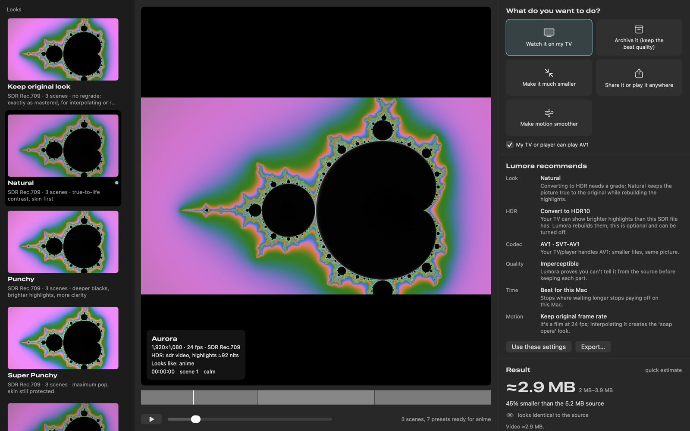
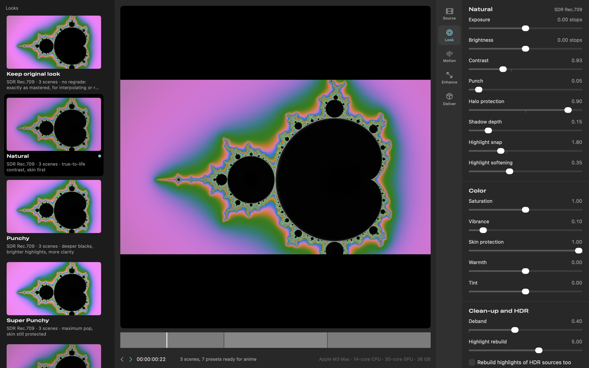
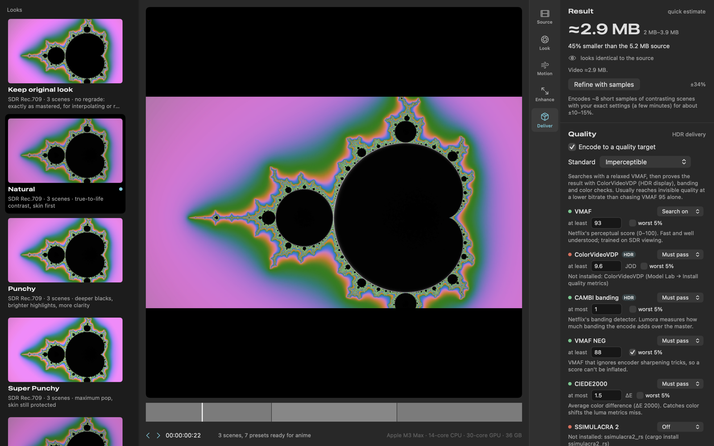
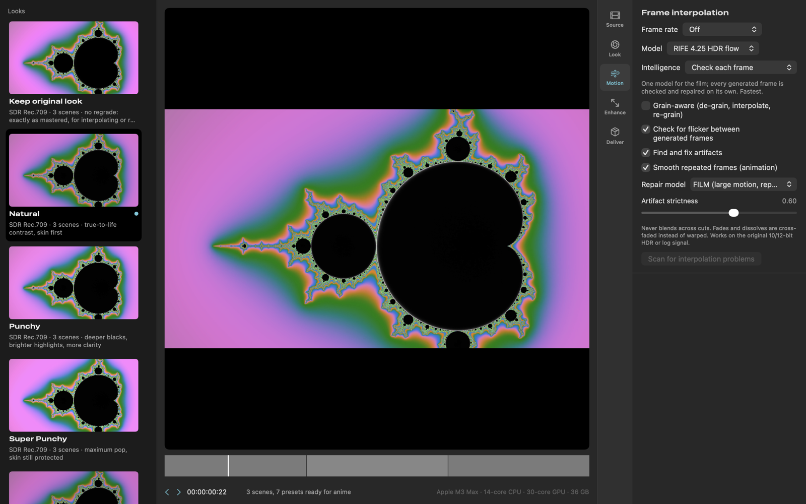
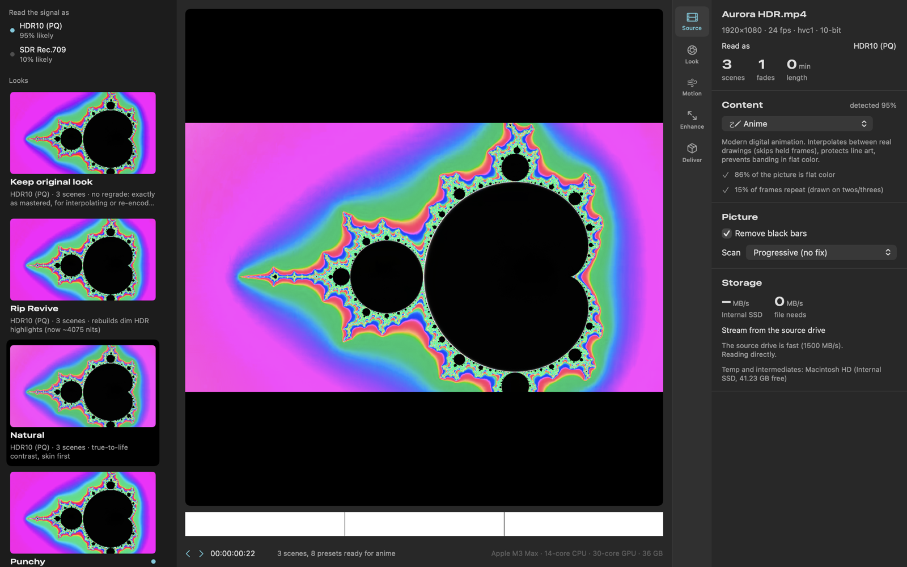
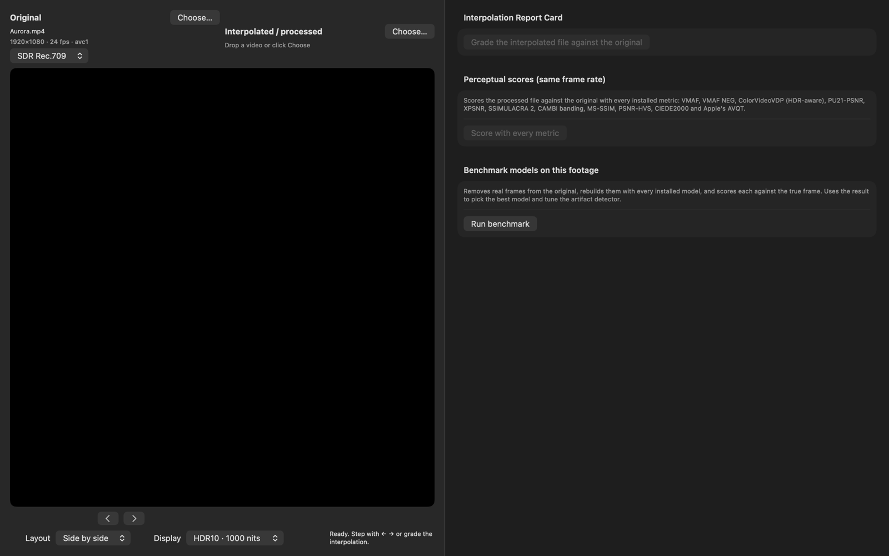
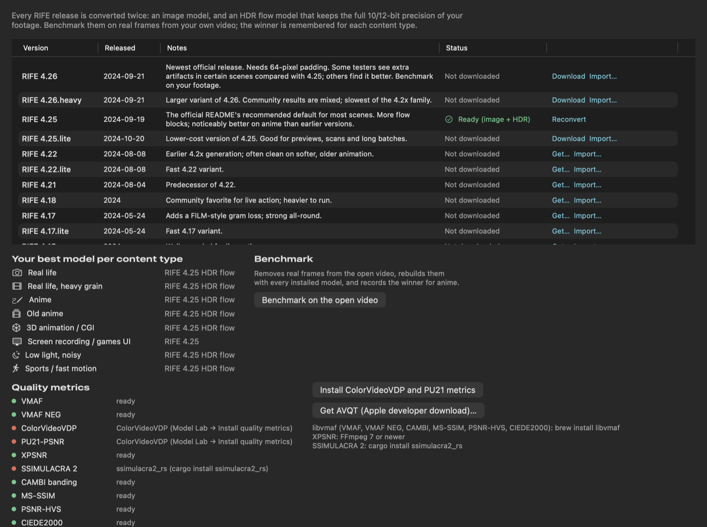

# Lumora
{: .fs-9 }

Grade, convert and rebuild video between SDR and HDR on your Mac — with frame interpolation, quality-target encoding
and plain-English advice for every setting.
{: .fs-6 .fw-300 }

[Get started](getting-started.md){: .btn .btn-primary .fs-5 .mb-4 .mb-md-0 .mr-2 }
[View on GitHub](https://github.com/info-moed/Lumora){: .btn .fs-5 .mb-4 .mb-md-0 }



| Grade every detail | Deliver exactly what you need | Smooth motion |
|---|---|---|
|  |  |  |
| **Read any HDR source** | **Compare original and interpolated** | **Convert and benchmark models** |
|  |  |  |

---

## What it does

| Feature | What it does |
|---|---|
| **SDR ⇄ HDR, HDR ⇄ HDR** | One color-managed engine turns SDR, HDR, camera log and RAW footage into natural or punchy **HDR10, HLG, Dolby Vision or SDR**, and remasters dim HDR. |
| **Every modern codec** | 10- and 12-bit **HEVC, ProRes, AV1, H.266/VVC** and experimental **AV2**: hardware encoding where the Mac has it, the best open-source encoders where it doesn't. |
| **Smoother motion** | **RIFE-class frame interpolation** that checks every generated frame, repairs bad ones, never interpolates across a cut, and keeps full 10/12-bit HDR precision. |
| **Encode to "looks identical"** | Instead of guessing a bitrate, Lumora finds the cheapest setting that passes VMAF plus HDR-aware checks for banding and color shifts. |
| **Explains itself** | Pick a goal (*watch on my TV*, *archive*, *make it smaller*…) and Lumora recommends every setting with a one-line reason. |
| **Finished files** | Plex/Infuse naming, private metadata stripped, audio and subtitles kept, checksums and NFO files written, and every file verified. |

---

## Install

**With Homebrew** (builds Lumora on your Mac and installs FFmpeg and the encoders):

```bash
brew install info-moed/lumora/lumora
```

**From source** — five commands, explained step by step in [Getting started](getting-started.md):

```bash
brew install xcodegen ffmpeg && git clone https://github.com/info-moed/Lumora.git && cd Lumora && xcodegen
```

Requires an Apple silicon Mac with **macOS 27** or later (and Xcode 27 to build).

---

## Where to start

| You are… | Read |
|---|---|
| New to Macs, Terminal or HDR | [Getting started](getting-started.md), then [HDR and video basics](hdr-basics.md) |
| Ready to use the app well | [User guide](user-guide.md) |
| Curious how every feature works | [Feature reference](features.md) |
| Choosing encoder settings | [Encoding settings](encoding/index.md): every option of every encoder, with recommendations |
| Comfortable in Terminal | [Building from source](building.md) and [Command line](command-line.md) |
| Going to change the code | [Architecture](architecture.md) |
| Stuck | [Troubleshooting](troubleshooting.md) |
| An export failed or stopped | [When a render fails](render-failures.md): what the messages mean, the export logs, resuming, repairing damaged files |

---

## Project status

Lumora builds and runs on macOS 27, and its core pipeline is verified end to end by automated tests on every push.
Several advanced features are written but still being verified. The
[status table](https://github.com/info-moed/Lumora#project-status) says exactly which.

Lumora is free and open source under the [MIT license](https://github.com/info-moed/Lumora/blob/main/LICENSE).
