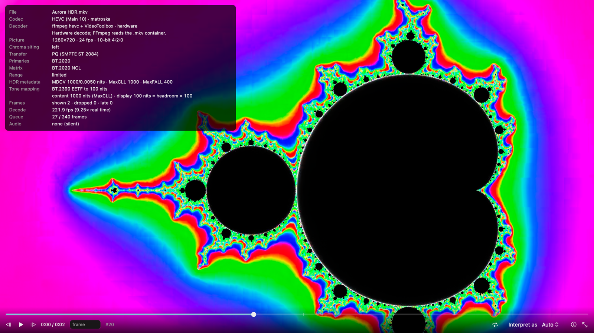

# The built-in Player

Lumora plays everything it can write or read, including the formats macOS can't: **AV2**, **H.266 / VVC**, AV1
(including 4:4:4 and 12-bit), HEVC up to 12-bit 4:4:4, H.264, ProRes, VP9 and uncompressed Y4M, in MP4, MOV, MKV,
WebM, TS, IVF and raw streams (.obu, .266, .vvc, .hevc). HDR is shown correctly on the screen you have: PQ, HLG and SDR,
tone mapped to the display's real headroom.

---

## Opening a file

- **File → Open in Player…** (⌥⌘O), or **Tools → Player…** for an empty Player window.
- **Drag a file** onto a Player window. (Dropping on the main window still opens it for grading.)
- **Finder:** right-click a video → **Open With → Lumora**. Files opened from Finder open in the Player, since opening
  a file from outside means "watch it". Lumora registers as an alternate handler, so your default player stays the
  default.
- **After an export:** the **Play** button next to "Saved …" in the status bar, **Play last export** in the Deliver
  tab, and **Play** in the Encode Monitor once the file is finished.
- **Library → Your exports** lists every file Lumora exported on this Mac, with **Play** and **Show in Finder**.
  "My copy" entries in the HDR ratings tab have **Play** too.

Several Player windows can be open at once. Closing one stops its decoders.

## Controls and shortcuts

| Key | Action |
|---|---|
| Space | Play / pause |
| K | Pause |
| L | Play; press again for 2× then 4× (audio is muted above 1×) |
| J | Play backward (frame by frame, about 8 fps) |
| ← / → | Previous / next frame |
| ⇧← / ⇧→ | Back / forward one second |
| Home / End | First / last frame |
| ↑ / ↓ | Volume |
| F or ⌃⌘F | Full screen |
| I | Info overlay |
| ⌘L | Loop |

The timeline shows key frames as ticks and, for pre-decoded files, the cached part in blue. Type a frame number in the
**frame** field to jump straight to it. Seeking always lands on the exact frame, even in open-GOP H.266 and HEVC.

**Interpret as** (Auto, SDR, PQ, HLG) overrides the file's transfer tag, for files that are tagged wrong. A raw
stream that carries no frame rate (AV2 .obu, AV1 .obu) gets a rate picker; Lumora remembers the choice per file.

## The info overlay

Press **I**. It shows what is playing and how:

- **Codec, container and decoder:** which tool decodes it, hardware or software, and why it was chosen.
- **Signal:** resolution, frame rate, bit depth, chroma format and siting, transfer, primaries, matrix and range.
  Values the file doesn't state are marked *(guessed)*.
- **HDR metadata:** mastering display, MaxCLL and MaxFALL, or which peak is assumed.
- **Tone mapping:** the content peak, the display peak right now, and the curve applied.
- **Notes:** Dolby Vision ("Dolby Vision 8.1: playing the HDR10 base layer"), HDR10+ ("dynamic metadata ignored,
  static HDR10 used"), BT.2020 CL / ICtCp matrices, and VVC files that may be HLG.
- **Live numbers:** frames shown, dropped and late; decode speed and real-time factor; queue depth; cache size.

## Which decoder plays what

Lumora picks the fastest decoder that is exact for each stream. Hardware decoding through AVFoundation hands frames to
the GPU without a copy; FFmpeg and the AVM reference decoder run as separate processes whose decoded frames come
through a pipe in their own pixel format. Lumora converts them on the GPU, so no decoder ever converts color.

Measured with the Player's own code (`PlayerBenchTests`) on an M3 Max with macOS 27.3 and FFmpeg 9.0.2, on a busy
shared Mac (load average about 10). The clips are short (20 to 60 frames), so the first-frame time is part of the
average; "steady" leaves it out.

| Video | Container | Decoder | Hardware | fps (1080p) | Steady fps | fps (4K) |
|---|---|---|---|---|---|---|
| H.264 8-bit | MP4 / MOV | AVFoundation (VideoToolbox) | yes | 704 | 817 | 218 |
| HEVC 10-bit 4:2:0 PQ | MP4 / MOV | AVFoundation (VideoToolbox) | yes | 697 | 799 | 222 |
| HEVC 10-bit 4:2:2 / 4:4:4 | MP4 | AVFoundation (VideoToolbox) | yes | 736 / 760 | 798 / 835 | – |
| HEVC 10-bit | MKV / TS | FFmpeg `hevc` + VideoToolbox | yes | 275 / 255 | 641 / 604 | – |
| HEVC 12-bit | any | FFmpeg `hevc` (VideoToolbox decodes 12-bit only in software, about 10× slower) | no | 294 | 507 | – |
| AV1 Main 10-bit | MP4 | AVFoundation (VideoToolbox, M3 and later) | yes | 566 | 661 | 198 |
| AV1 Main 10-bit | MKV / WebM / IVF / .obu | FFmpeg `av1` + VideoToolbox | yes | 268–300 | 571–653 | – |
| AV1 4:4:4, 4:2:2, 12-bit; AV1 without hardware | any | FFmpeg `libdav1d` | no | – | – | – |
| ProRes 422 HQ / 4444 | MOV | AVFoundation (VideoToolbox) | yes | 626 / 622 | 786 / 784 | 217 |
| VP9 10-bit | WebM / MKV | FFmpeg `vp9` (faster than libvpx and VideoToolbox's software VP9) | no | 298 | 572 | 61 (steady 130) |
| H.266 / VVC 10-bit | raw .266, MP4, MKV | FFmpeg's native `vvc` | no | 123–146 | 217–263 | 22–26 (steady 85–93) |
| AV2 10-bit | .obu / IVF / WebM | `avmdec` (AVM 15.0.0 reference decoder) | no | 9.3 | 10.2 | about 2 (estimate) |
| Y4M 10-bit | .y4m | FFmpeg `rawvideo` | no | 467 | 635 | – |

FFmpeg's 1080p numbers include about 0.1 s to start the process; that is why they look lower than AVFoundation's. The
pipe carries 4K 10-bit at about 60 to 70 frames per second, plenty for 4K24 to 4K50; frames buffered ahead cover the
rest. A dav1d measurement (AV1 4:4:4 at about 650 fps at 1080p) is from the design research; the bench files had no
4:4:4 AV1.

If VideoToolbox can't start on a stream (an unusual profile or size), FFmpeg falls back to software decoding and the
overlay says so. **Settings → Player → Prefer hardware decoding** off uses software for everything.

### AV2 is pre-decoded

There is no fast AV2 decoder yet; the AVM reference decoder manages about 8 to 10 frames per second per process at 1080p,
and threads barely help. So the Player **pre-decodes AV2 to disk**: several `avmdec` processes (Settings → Player →
Parallel pre-decoders, default up to 3) each decode a stretch between two key frames, always the stretch just ahead
of the playhead first. Frames are compressed with LZFSE (about 3× on 10-bit video, decoded at about 1 GB/s) into the
**player cache** in your scratch folder.

Playback starts once enough is cached that it can't run dry at the measured speed (at least 3 seconds); the banner
shows the reason, progress and when playback starts. Seeking into a cached stretch is instant; elsewhere the decoder
starts at the nearest key frame and decodes forward, and the Player says so. Any other decoder that stays slower than
real time (4K H.266 on a busy Mac, for example) switches to the same pre-decode cache automatically.

The cache never uses more than **Settings → Player → per-file limit** (default 16 GB) or a quarter of the free space,
never more than 40 GB across files, and never lets the scratch drive drop below 10 GB free. When it is full it keeps a
sliding window around the playhead. Caches untouched for a week, or whose file changed, are removed at launch;
**Clear player cache** removes them all.

### Raw streams

A raw .266 / .hevc / .obu stream has no index, so at first seeking decodes forward from the start. In the background the
Player copies it into an MP4 in the player cache (`MP4Box`, skipped when space is short) and from then on seeks
directly.

## HDR on your screen

Every frame goes from the decoder's own samples to the display in one GPU pass:

1. **Samples to code values** at the true bit depth (8, 10, 12 or 16), from planar, semi-planar (p010 and friends) or
   VideoToolbox textures.
2. **Chroma** is interpolated at its real position (left, center, top-left… as tagged; left when untagged).
3. **Range and matrix:** limited or full range; BT.709, BT.2020 NCL, BT.601, YCgCo or GBR.
4. **Transfer to light:** PQ (SMPTE ST 2084) in absolute nits; HLG through the BT.2100 system gamma for the display's
   peak (γ = 1.2 at 1000 nits, 1.033 at 400, 1.326 at 2000); SDR through BT.1886 (gamma 2.4).
5. **Primaries** converted to BT.2020.
6. **Tone mapping** with the BT.2390 EETF to what the screen can show right now: its EDR headroom (read every frame and
   smoothed, so brightness changes are followed without flicker) × the reference white. When the screen reaches the
   content's peak, nothing is tone mapped.
7. Out as extended-linear BT.2020 to an EDR layer. On an SDR screen the headroom is 1, so everything fits SDR white.

**Which peak:** MaxCLL when present and sane, else the mastering display's peak, else the peak Lumora recorded when it
exported the file (AV2 can't carry mastering metadata), else **Settings → Player → Assume untagged HDR peaks at**
(default 1000 nits).

**Reference white:** 100 nits by default (Apple's EDR convention, the same as the grading viewer), or 203 nits
(BT.2408). Reference modes on Pro Display XDR and MacBook Pro always use 100 nits.

**Tone mapping: macOS** in Settings passes the PQ or HLG signal through with its metadata and lets macOS tone map, for
comparison.

**Dolby Vision and HDR10+:** profiles 8.x and 7 play their HDR10 (or HLG) base layer; profile 5 is converted to PQ by
macOS, which works only from MP4 or MOV (profile 5 in MKV is refused with an explanation). HDR10+ plays as HDR10.

## Audio

Audio plays in sync on the audio clock: the frame on screen is the one due at the moment its sound reaches your
speakers or headphones, output latency included. MP4 and MOV audio is decoded by AVFoundation, everything else by
FFmpeg. Several audio tracks get a picker. Files without audio (raw streams) play on the system clock.

## When something can't play

The Player says what is wrong and what to do:

| Message | What to do |
|---|---|
| This file needs "avmdec" | `bash scripts/install-encoders.sh` builds avmenc and avmdec |
| This file needs "ffmpeg" | `brew install ffmpeg` (or `scripts/deps.sh install`) |
| This FFmpeg can't decode H.266 | FFmpeg 7.1 or newer: `brew upgrade ffmpeg` |
| FFmpeg was built without dav1d | Homebrew's FFmpeg includes it: `brew reinstall ffmpeg` |
| Dolby Vision profile 5 in Matroska | Remux to MP4 or MOV |
| damaged / impossible size / no video track | The file is broken or not a video |

`scripts/deps.sh status` lists the decoders the Player can use; `scripts/deps.sh verify` checks that avmdec still
accepts every option the Player passes it.

## Settings → Player

| Setting | Default |
|---|---|
| Tone mapping | Lumora (BT.2390) |
| SDR reference white | 100 nits |
| Assume untagged HDR peaks at | 1000 nits |
| Prefer hardware decoding | on |
| RAM for decoded frames | 4 % of memory, at most 1.5 GB |
| Parallel pre-decoders | up to 3 (a quarter of the cores) |
| AV2: skip film grain synthesis | off |
| Pre-decode cache per file | 16 GB |

## Limits

- Variable frame rate: files FFmpeg decodes follow the exact frame times from FFmpeg's packet list; files AVFoundation
  decodes play at their nominal rate.
- Reverse play steps frame by frame; on uncached AV2 it is off.
- Settings changes apply to Player windows opened afterwards.
- The automated tests check every number on the way to the screen offscreen; how it looks on a real HDR display is not
  something they can check.
