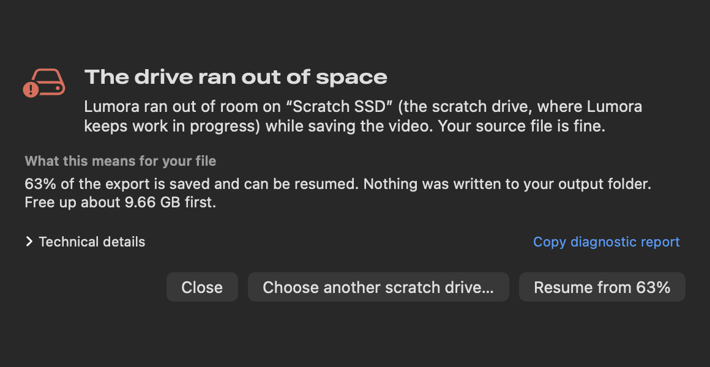
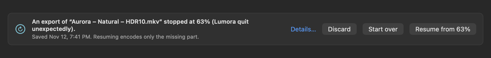

# When a render fails

Exports can stop for reasons that have nothing to do with Lumora: a drive fills up or is unplugged, the Mac
restarts, an encoder crashes, or the source file turns out to be damaged. Lumora is built so that when this happens
you lose as little as possible, and you always know what happened and what to do next.

- Every export writes a detailed **log**.
- A failure is explained in **plain words**, with one or two things to do.
- Exports are saved in **checkpoints**, so you can **resume** from where they stopped instead of starting over.
- **Broken or damaged sources** are found when you open them, explained, and can be **repaired into a new file**.



---

## What you see when an export fails

Instead of a generic error, Lumora shows a sheet with:

1. **What happened**, in one sentence ("Lumora ran out of room on “Scratch SSD” while saving the video. Your source
   file is fine.").
2. **What this means for your file** ("63% of the export is saved and can be resumed. Nothing was written to your
   output folder.").
3. **One or two buttons** that fix it (for example *Resume from 63%* or *Save to another folder…*).
4. **Technical details**, collapsed: the step that failed, the tool and its version, its exact command line, exit
   status or signal, the full error chain, the tool's last error lines, the state of the Mac at that moment (free
   space, memory pressure, heat, sleep) and where the log is. Pro mode also shows a one-line technical summary.

Simple mode never shows error codes, signal names or other jargon in the explanation itself; they are one click away
under *Technical details*.

| What went wrong | What Lumora says | What you can do |
|---|---|---|
| A drive filled up | The drive ran out of space (and which drive: the scratch drive or your output drive) | Free some space and *Resume*, or choose another scratch drive. If only the final copy failed: *Save to another folder…* (nothing is rendered again) |
| The output drive was unplugged, or its folder was deleted | The output drive was disconnected | *Save again* once it's back, or *Save to another folder…*; the finished video is kept |
| The folder is read-only | Lumora isn't allowed to save there | *Save to another folder…* |
| macOS privacy settings block the folder | macOS is blocking access to this folder | *Open Privacy & Security settings* |
| An encoder or helper tool isn't installed | A helper tool is missing (names it and what it's for) | *How to install*, or choose another codec |
| An encoder crashed | The (encoder) crashed while encoding 0:41–1:12 | Lumora already retried that part once; *Resume* or copy the diagnostic report |
| An encoder refused a setting | The encoder didn't accept a setting (names the option and its allowed range) | *Reset to recommended settings* |
| An encoder stopped with an error | The (encoder) stopped with an error (quotes its last error line) | *Resume*, or copy the diagnostic report |
| The Mac ran out of memory | Your Mac ran out of memory | *Resume using less memory* (one part at a time) |
| The GPU reported an error | The graphics processor reported an error at mm:ss | Retried once automatically; *Resume* |
| The hardware encoder reset (often after sleep) | The Mac's video encoder stopped responding | Retried twice automatically; *Resume* |
| Lumora was quit, crashed, or the Mac restarted or lost power | The export was interrupted (and why, as far as Lumora can tell) | *Resume from 63%*, *Start over* or *Discard* |
| You stopped it | You stopped the export | If you chose *Stop and keep progress*: *Resume* later |
| The source is cut short, damaged, or missing its index | This video file is cut short / Part of this video is damaged / This video file is incomplete | *Repair a copy* (see below), or export what's there |
| The source changed or was moved during the export | The source file changed / was moved or deleted | *Locate the file…* (resumes if it's the same file) or *Start over* |
| Dolby Vision, HDR10+ or packaging tools failed | Adding Dolby Vision metadata failed / Packaging the file failed. The video itself was encoded fine | *Try the last step again* (no re-encoding), or *Save without Dolby Vision (HDR10 only)* |
| The finished video would be missing frames | Lumora found a gap in the finished video; it isn't saved | *Resume* re-checks every saved part and redoes only bad ones |
| Anything else | Lumora doesn't recognize this error (and quotes it) | *Resume*, copy the diagnostic report, or open the log |

Short problems that usually go away by themselves are retried automatically before you see anything: a crashed
encoder (once), a GPU fault (once), a hardware encoder reset (twice) and an encoder killed while memory was low (once,
after memory frees up). Settings, missing tools and damaged sources are never retried, because retrying can't fix them.
When the scratch drive gets nearly full, Lumora **pauses** the export ("Paused: “Scratch SSD” is almost full (1.2 GB
left). Free up space and Lumora continues.") instead of failing.

While an export runs, Lumora keeps the Mac from going to sleep on its own. If you put it to sleep anyway, the log notes
how long it slept and the export continues when it wakes.

---

## The export log

Every export writes its own log file, always (it's cheap):

```
~/Library/Logs/Lumora/Exports/2026-11-12 16-41-07 clip – Natural – HDR10.log
```

Open them from **Tools → Log → Export logs…**: the window lists every export with its date, file, result and size,
and can open a log, show it in Finder, or copy a diagnostic report.

A log holds:

- **The settings**: Lumora and macOS versions, the Mac, the source (size, codec, resolution, frame rate, color,
  audio), every export setting, the encoder plan, grain and interpolation, and the version of every tool the export
  may run.
- **Every command line**, in full, with your home folder written as `~`.
- **Each step** with its duration: grain, light levels, every segment, checks, join, metadata, saving.
- **Progress counters** (frames done and speed, every 10 seconds per segment).
- **Each tool's own messages**: the last lines after a good segment, the last 200 lines after a failure.
- **Warnings** (for example when the hardware encoder ignores a setting) and **system events** (sleep and wake, a
  drive being unplugged, memory pressure, heat).
- On failure, **WHAT HAPPENED** (the explanation above), **TECHNICAL** (the full error chain) and the state of the
  Mac at that moment; on success, the finished file and its size.

Logs are capped at 16 MB each (past that, only warnings, errors and steps are written) and pruned automatically: 30
days or 200 logs, at most 256 MB together. The log of an export that can still be resumed is never deleted.

### Copy diagnostic report

*Copy diagnostic report* (in the failure sheet and the Export logs window) puts a single plain-text report on the
clipboard, ready to paste into an [issue](https://github.com/info-moed/Lumora/issues). It contains the explanation,
the technical details, the settings, the tool versions, which segments were saved, the last 300 log lines and, after a
crash, the crash type. Before it is copied, Lumora removes your account name, your full name, the computer's name,
drive names, the source and output file names, and anything that looks like an email address or a serial number. It
never includes your video, its frames, or the raw progress journal. Read it before you share it; it's plain text so
that is easy.

---

## Resuming an export



Lumora encodes every export in **segments** of a few minutes of encoding each. When a segment is finished it is
flushed to the drive, checked (the right number of frames, its keyframes decode, a checksum), and recorded in a small
journal. If the export stops for any reason, at most the segments being encoded at that moment are lost.

Next time you open Lumora (or right after a failure), a banner offers **Resume export from 63%**, along with *Start
over* and *Discard*. The Export sheet shows the same offer as a checkbox when the saved progress matches what you are
about to export. Resuming checks every saved segment again, encodes only what is missing, joins everything and adds the
HDR metadata as usual. The result has exactly the same frames and timestamps as an export that never stopped:

- the segment plan is fixed when the export starts and reused on resume;
- each segment starts with a few frames rendered but not encoded, so the grade's frame-to-frame smoothing is the same
  as in an unbroken run;
- the HDR light levels and the grain plan are measured once and saved;
- Dolby Vision and HDR10+ metadata are written for the whole joined video, so they stay aligned frame by frame;
- audio and subtitles always come from the source.

Measured on this project's tests (real exports, interrupted and resumed in a fresh engine): SVT-AV1, libaom, x265 and
VVenC, the hardware HEVC and ProRes encoders give decoded frames identical to an uninterrupted export, with the same frame
count, timestamps, audio, color tags, mastering-display and light-level metadata; AV2 gives a byte-identical stream;
Dolby Vision RPUs and HDR10+ metadata are byte-identical. Target-quality (VMAF) exports resume per chunk: finished
chunks keep their pieces and chosen levels, and only the missing chunks are searched again.

Lumora refuses to resume (and says why) when mixing old and new parts could show: the source file changed, the
encoder or its version changed, Lumora itself renders this export differently now, or (for the hardware encoders) the
Mac or macOS changed since the export began. Pro mode can resume anyway in that last case.

Saved progress lives in the scratch folder, under `Checkpoints`. It is removed when the export finishes, expires
after 14 days, and the oldest is removed first when all of it would take more than a quarter of the scratch drive's
free space. **Settings → Storage → Saved progress** shows how much space it uses and can discard it. Stopping an
export normally discards its progress; Simple mode asks whether to **Stop and keep progress** (in Pro mode, Option-click
*Stop*). Files in a batch resume their own saved progress automatically, and a file that fails is explained, marked in
the queue and skipped, so the rest of the batch goes on.

**VVC (H.266):** the packager (GPAC 26.07) mis-times a VVenC stream joined from parts shorter than one VVenC group of
pictures (32 frames) and drops pictures. Lumora's VVC segments are therefore always at least 64 frames long (in
practice they are minutes long), and the frame-count check would refuse a file with missing frames ("Lumora found a gap
in the finished video") rather than save it.

---

## Broken or damaged sources

When you open a file, Lumora checks it in well under a second and shows the result in the Source panel (and in Simple
mode): **File check: OK**, **Damaged: 2 frames at 0:01.9**, **Cut short: stops at 0:02.4 of 0:04.0**, **Broken
timestamps near 0:01.9**, or **Incomplete: the index is missing**. A file named `.mp4` that is really another format is
only a note: Lumora reads it anyway. *Full check…* decodes every frame and lists all the damage.

Analysis and exports read on past damage instead of stopping at the first bad frame. Pictures that can't be decoded
are replaced by the previous good picture, so the timeline never shifts (audio, subtitles and HDR metadata stay in
sync), and every replaced frame is written to the export log.

**Repair a copy…** writes a new file next to the source, named `clip (repaired).mkv` (or into your Movies folder when
the source's folder can't be written). **Your original file is never changed.**

| Problem | What the repair does |
|---|---|
| Cut short, or the container is damaged | Rebuilds the file structure without re-encoding and keeps every frame that is there; if what's left still has damaged pictures, re-encodes just those parts |
| Broken timestamps | Rebuilds the timing from the order of the pictures, without re-encoding (measured: frames bit-identical to the undamaged file) |
| Damaged frames | Re-encodes only the damaged groups of pictures at very high quality and copies everything else as is; pictures that can't be decoded are rebuilt by repeating the previous good one. Measured: 72 of 96 frames bit-identical, the 24 frames of the rebuilt part listed in the report, exact frame count and timestamps, clean decode |
| The index is missing (a recording or copy was interrupted before the end) | Can't be repaired from this file alone; Lumora says so and writes nothing. Find the original on the camera card or another complete copy; a recovery tool that uses a working clip from the same camera as a pattern may be able to rescue it |

The repair report says exactly what was done ("1 frame rebuilt at 0:01.9 (repeated from the previous frame). 24
frames re-encoded at high quality (0:01.00–0:02.00). All other frames are untouched."). *Use the repaired copy* opens it
and keeps the look you chose.
