# User guide

How to use every part of Lumora. If you haven't installed it yet, start with [Getting started](getting-started.md).
For the theory behind the settings, see [HDR and video basics](hdr-basics.md); for the deep technical reasoning behind
each feature, see the [Feature reference](features.md).

> Some features described here are written but not yet verified end to end. Check
> [Project status](https://github.com/info-moed/Lumora/blob/main/README.md#project-status) before relying on one for important work.

---

## Contents

- [The main window](#the-main-window)
- [Opening files](#opening-files)
- [Simple mode](#simple-mode)
- [Pro mode](#pro-mode)
  - [Looks sidebar](#looks-sidebar)
  - [Preview, scene strip and transport](#preview-scene-strip-and-transport)
  - [Toolbar](#toolbar)
  - [Source tab](#source-tab)
  - [Look tab](#look-tab)
  - [Motion tab](#motion-tab)
  - [Enhance tab](#enhance-tab)
  - [Deliver tab](#deliver-tab)
- [Exporting](#exporting)
- [The Tools menu](#the-tools-menu)
- [Other windows](#other-windows)
- [Settings](#settings)
- [Keyboard shortcuts](#keyboard-shortcuts)
- [Where Lumora keeps things](#where-lumora-keeps-things)
- [Recipes](#recipes)

---

## The main window

```
┌──────────────┬─────────────────────────────────────────┬───────────────────────┐
│ Looks        │  Preview (HDR on XDR / HDR screens)     │ Source Look Motion    │
│ (presets     │                                         │ Enhance Deliver       │
│  built for   │                                         │                       │
│  this file)  ├─────────────────────────────────────────┤ (Pro mode inspector,  │
│              │  Scene strip                            │  or Simple mode's     │
│              │  ◀ ▶ timecode · status · your Mac       │  goals + advice)      │
└──────────────┴─────────────────────────────────────────┴───────────────────────┘
```

Switch between **Simple** and **Pro** with the selector in the middle of the toolbar. Lumora remembers your choice.

---

## Opening files

- **Drag and drop** a file onto the window, use **File → Open… (⌘O)**, or the **Open** button.
- Lumora accepts:
  - Anything AVFoundation reads: MOV, MP4, M4V with H.264, HEVC, ProRes, ProRes RAW, AV1; HDR10, HLG and Dolby
    Vision 5/8 sources.
  - Anything FFmpeg reads, if FFmpeg is installed: MKV and more.
  - **CinemaDNG / DNG sequences**: open the *folder*.
  - **Camera RAW stills** from most cameras.
  - BRAW, R3D, ARRIRAW and Canon RAW need the vendor's SDK as a plug-in (not yet available).
- On opening, Lumora:
  1. reads how the file is encoded (color, HDR format, camera log profile),
  2. checks the drive's speed and decides whether to stream or copy it to your scratch drive,
  3. looks for black bars,
  4. reads every frame once: scenes, brightness, motion, grain, and a small preview proxy,
  5. runs a **content test** (real life, anime, grainy film, screen recording…),
  6. builds **looks** adapted to this footage.

Your source file is never modified, and nothing is written next to it.

---

## Simple mode

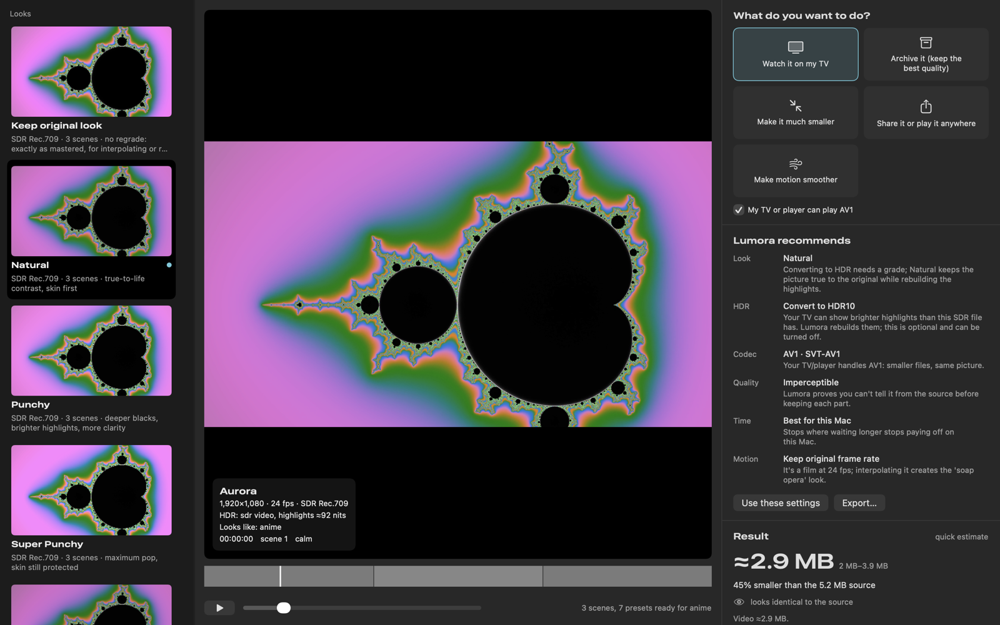

Simple mode is a three-step flow on the right-hand side, beside a playable preview.

1. **What do you want to do?** Pick a goal:

   | Goal | Lumora aims for |
   |---|---|
   | Watch it on my TV | Best picture for an HDR TV; HDR10 or Dolby Vision |
   | Archive it (keep the best quality) | Visually lossless, efficient codec, quality checks on |
   | Make it much smaller | Biggest savings that still look good |
   | Share it or play it anywhere | Maximum compatibility |
   | Make motion smoother | Higher frame rate with interpolation |

   Untick **My TV or player can play AV1** if yours can't. Lumora then prefers HEVC.

2. **Lumora recommends** lists the look, HDR format, codec, quality standard, time budget and motion handling. Each
   has a one-line reason. **Use these settings** applies them; **Export…** applies them and opens the export sheet.

3. **Result** estimates the finished size, how it compares to the source, and how it will look. **Refine with
   samples** encodes a few short samples for a tighter estimate.

Also in Simple mode:

- **Info panel** on the picture: resolution, frame rate, HDR verdict and highlight level, content type, scene and
  motion at the current position.
- **Play / pause** with the button or the **space bar**.
- **Busiest moments → Test smoothing** shows the hardest-motion part of the film interpolated next to the original,
  before you commit.
- **More control** opens the key settings without switching to Pro mode.

---

## Pro mode

### Looks sidebar

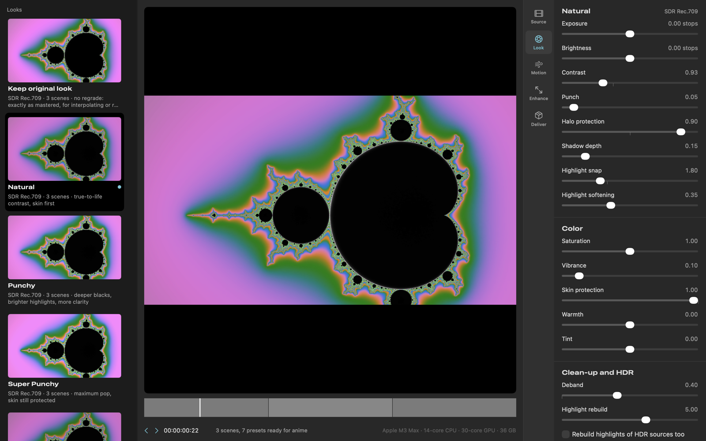

The left column lists **looks** built for this file, each with a thumbnail rendered from your footage:

| Look | Character |
|---|---|
| **Keep original look** | No regrade. For interpolating, upscaling or re-encoding without changing the picture. |
| **Natural** | True-to-life contrast, skin first. |
| **Punchy** | More contrast and color. |
| **Super Punchy** | Maximum pop, skin still protected. |
| **Cinematic** | Filmic contrast and roll-off. |
| **Bright & Clean** | Lifted, clean, airy. |
| **Moody** | Darker, denser. |
| **Rip Revive** | HDR sources only: expands a dim HDR master's highlights to a brighter target. |

When a camera log can't be identified for certain (e.g. Apple Log vs Apple Log 2), you get looks for each
interpretation. Compare them and pick the one that looks right. The recommended look is marked.

### Preview, scene strip and transport

- **Preview:** on an XDR or HDR display, you see the actual HDR output via EDR. On SDR screens the preview is tone
  mapped.
- **Scene strip:** one block per detected scene. The top row is the *pain-point map*: each scene's interpolation
  model, confidence and expected repair rate (when a motion map exists).
- **Transport:** **◀ / ▶** (or the **←/→** keys) step one frame; timecode, progress, status and your Mac's chip
  are shown alongside.

### Toolbar

| Control | What it does |
|---|---|
| **Open** | Open a file or folder. |
| **Pause / Resume** | Pauses rendering and encoding without losing work. |
| **TV preview** | Opens the AirPlay preview window. |
| **Simple / Pro** | Switches modes. |
| **Display as** | Which output the preview shows: HDR10 at 1000, 2000 or 4000 nits, HLG, or SDR. |
| **Before / after** | Split view: the ungraded signal beside the grade. |
| **False color** | Colors the picture by brightness, to see exposure at a glance. |
| **Nits picker** | Click the picture to read the exact brightness of a point. |
| **Scopes** | HDR scopes under the preview: a luminance waveform on the PQ scale with nit markers, and a CIE 1931 chromaticity plot. |
| **Activity** | Every running task with progress, rate and time remaining. |
| **Tools** | The [Tools menu](#the-tools-menu). |
| **Export (⌘E)** | Opens the export sheet. |

### Source tab

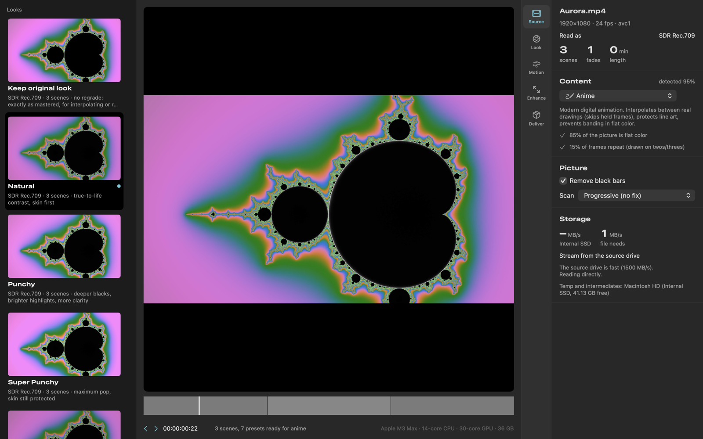

- **File facts:** resolution, frame rate, codec, how Lumora reads the color ("Read as"), scene and fade counts,
  length.
- **Content:** the detected content type and confidence, with the evidence ("94% of the picture is flat color").
  Override it here; it tunes interpolation, artifact strictness, grain handling, encoder flags, quality target and
  upscaler. Types: real life, real life with heavy grain, anime, old anime, 3D/CGI, screen content, low light, fast
  motion.
- **Picture:** **Remove black bars** (on by default when bars are found) and **Scan** fix for interlaced or
  telecined sources.
- **Storage:** your scratch drive's speed vs what this file needs, and whether Lumora streams the source or copies it
  to the scratch drive first.

### Look tab

- **Tone:** Exposure, Brightness, Contrast, Punch (local contrast), Halo protection, Shadow depth, Highlight snap and
  Highlight softening.
- **Color:** Saturation, Vibrance, Skin protection, Warmth and Tint.
- **Clean-up and HDR:** Deband, Highlight rebuild, **Rebuild highlights of HDR sources too**, and **Keep the original
  look (no regrade)**.
- Every slider previews live and resets to the look's value. **Save changes to this preset** keeps your changes.
- **Matched to reference:** appears after **Tools → Match to a reference release…**; **Remove match** undoes it.

### Motion tab

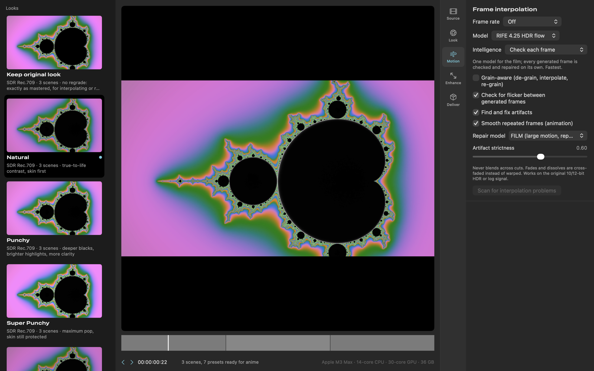

- **Frame rate:** off, 2×/3×/4×/8×, an exact target (e.g. 60 or 59.94), or slow motion.
- **Model:** which interpolation model to use (installed Core ML models, or blending if none are installed).
- **Intelligence:**
  - *Check each frame*: one model for the film; every generated frame is checked and repaired. Fastest.
  - *Route a model per scene*: tests likely models on each scene and uses each scene's winner.
  - *Exhaustive until confident*: tests every installed model until the winner is proven. Very slow, maximum
    quality.
- **Grain-aware**, **Find and fix artifacts**, **Smooth repeated frames (animation)**, and the **Second opinion**: the
  flow model that generates every frame a second time so the artifact checker can keep the better version, tile by
  tile. **Automatic** uses the best installed flow model; without one, Model Lab shows how to install it.
- **Scan for interpolation problems:** a fast proxy-resolution pass that lists every frame that would need repair.

### Enhance tab

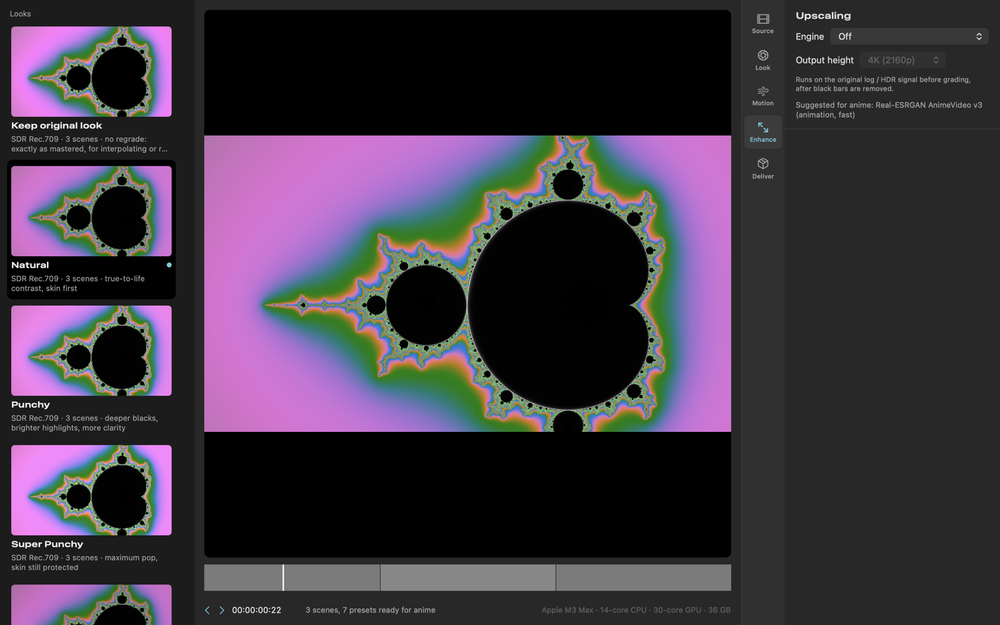

- **Upscaling:** **Engine** (off, MetalFX, or one of five Real-ESRGAN models) and **Output height** (up to 12K).
  Models that aren't installed are listed as "(not installed)" and can't be picked; a line below says how many are
  installed. Upscaling runs after black-bar removal and before grading. MetalFX is best for clean sources;
  Real-ESRGAN (general v3 first) for compressed ones. See [Upscaling](features.md#upscaling) for the measurements.

### Deliver tab

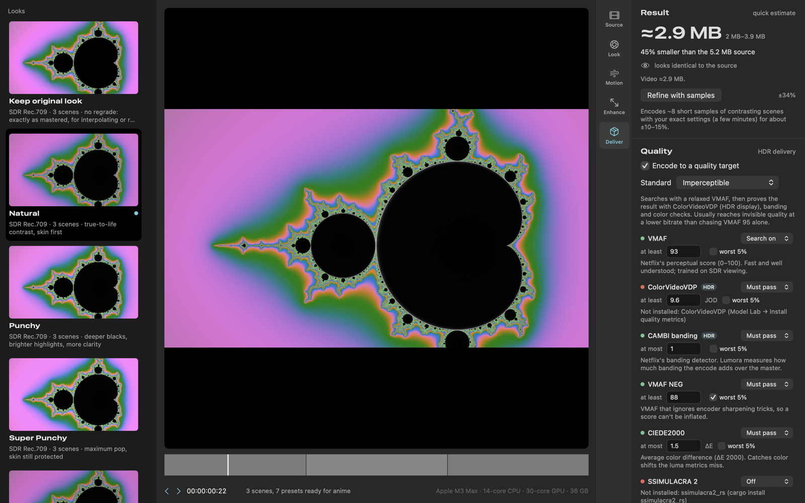

- **Format:** HDR format, codec, bit depth and chroma, with a line about Dolby Vision (whether the film's own
  metadata is kept, or why new metadata is written). **What should I export?** opens the plain-English advisor.
- **Quality:** fixed quality, or **Encode to a quality target** with a standard (e.g. Imperceptible), the metric
  rules, **Re-encode stretches that dip below target**, and **Fast validation**.
- **Time and quality:** how long you're willing to wait (Fastest, Time budget, Best for this Mac, Maximum), and what
  more time would buy.
- **Result:** size forecast with a range, the comparison to the source, and **Refine with samples**.
- **Film texture:** for AV1, adds organic film grain at playback at no bitrate cost.
- **Grade for a screen:** targets this Mac's display or a device class (OLED TV, mini-LED TV, iPhone…), with
  **Make it pop on this screen** to use the screen's full headroom.
- **Name and library / Metadata already in the file / Appendices:** packaging. Plex/Infuse naming, keep or strip
  personal metadata, add your own, choose tracks, and pick sidecar files (settings, quality report, checksum, NFO,
  poster, chapters, HDR report, log).
- **Export…** and **Open encode monitor**.

---

## Exporting

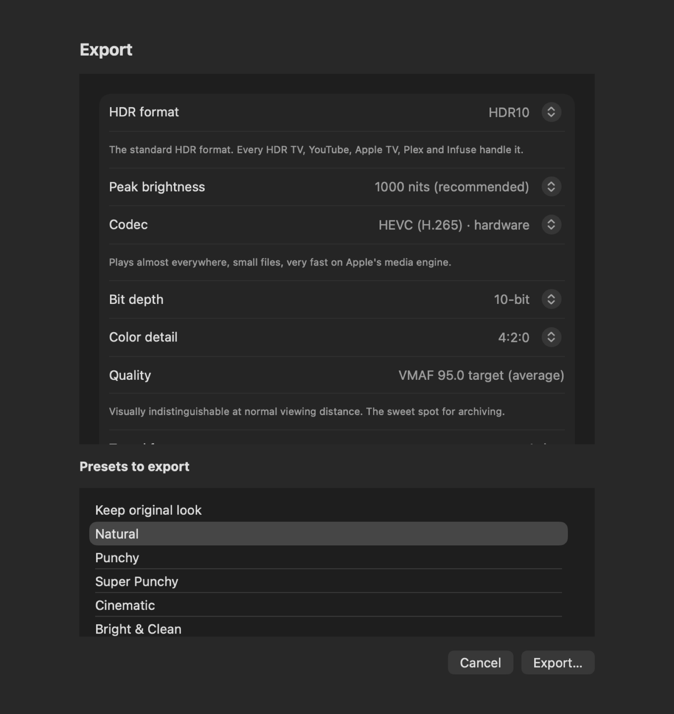

1. Click **Export (⌘E)**.
2. In the sheet, check **HDR format**, **Peak brightness** (1000 nits recommended), **Codec**, **Bit depth**,
   **Color detail** (chroma) and **Quality**.
3. Tick the **presets to export**. You can export several looks in one go.
4. Optionally keep **Also export the original frame rate** to compare interpolated vs original.
5. Click **Export…** and choose a folder (**Export Here**).

Files are named `<source> – <look> – <format>.<ext>`. The container is chosen for you: `.mov`/`.mp4` for hardware
codecs from AVFoundation sources, `.mkv` for AV1, VVC, Dolby Vision 8.1 / HDR10+ and sources read through FFmpeg,
and `.obu` for AV2.

Progress shows at the bottom of the window and in **Activity**. Use **Pause** to pause; work isn't lost.

---

## The Tools menu

| Item | What it does |
|---|---|
| **Compare original and interpolated…** | Opens the Compare window with this file. |
| **Match to a reference release…** | Matches the grade's tone to another release of the same film. |
| **HDR report** | Plain-English report card on the source's HDR (brightness, highlights, verdict). |
| **Export HDR still…** | Saves the current frame as an HDR still image. |
| **LUT → Export .cube, 33 / 65 points** | Saves the selected look as a 3D LUT. |
| **Save look as preset… / Import preset…** | Share looks between files. |
| **Batch process a folder…** | Applies the current settings to every video in a folder; the queue survives quitting. |
| **Estimate sizes for a folder…** | Archive-wide size totals from metadata alone. |
| **Optimize for this Mac…** | Benchmarks your Mac and stores the fastest settings. |
| **Preview on your TV (AirPlay)…** | Renders 15 s and plays it on an Apple TV. |
| **Picture regression set…** | Reference frames that are re-checked after updates. |
| **Verify an archive folder…** | Re-hashes files that have checksum sidecars and lists mismatches. |
| **Resume unfinished batch…** | Only shown when a batch was interrupted. |
| **Model Lab / Encode monitor / Log / UHD HDR library** | Open those windows. |

---

## Other windows

| Compare | Model Lab |
|---|---|
| 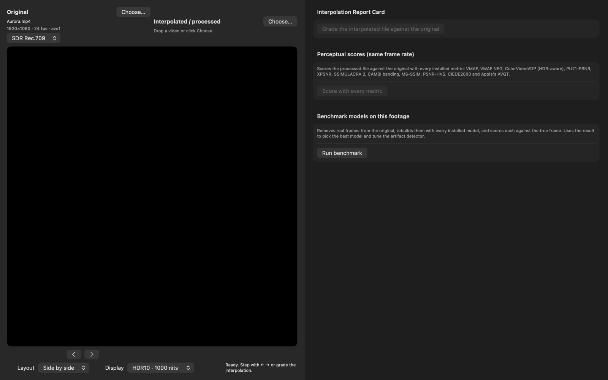 | 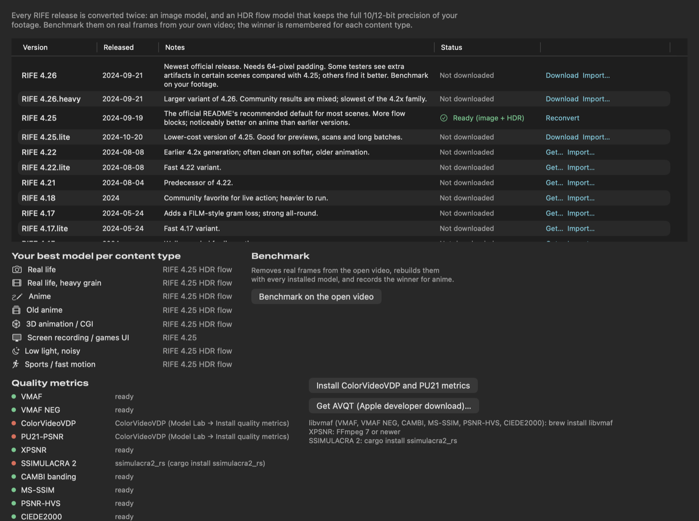 |
| **Encode monitor** | **Optimize for this Mac** |
| 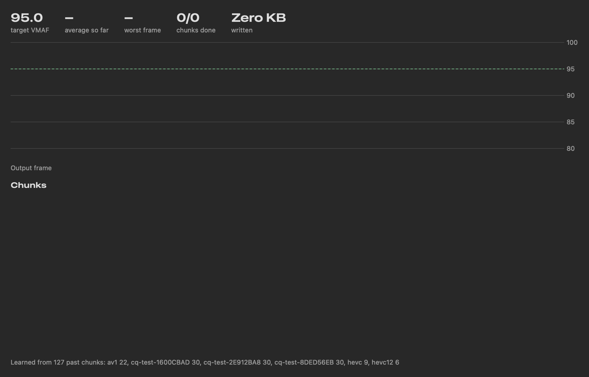 | 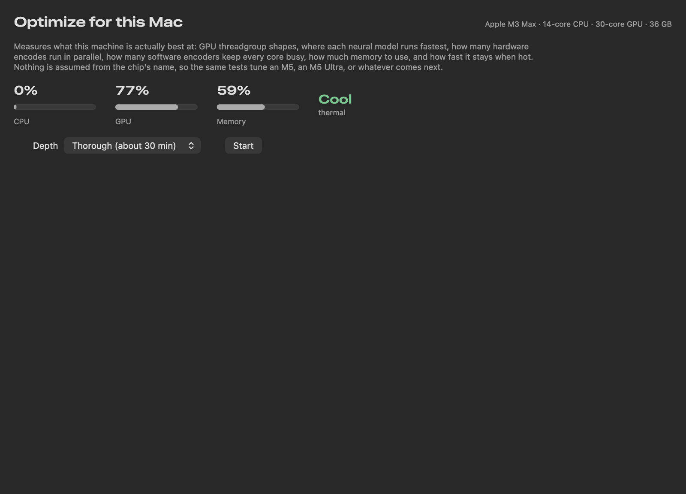 |
| **UHD HDR library** | **Log** |
| 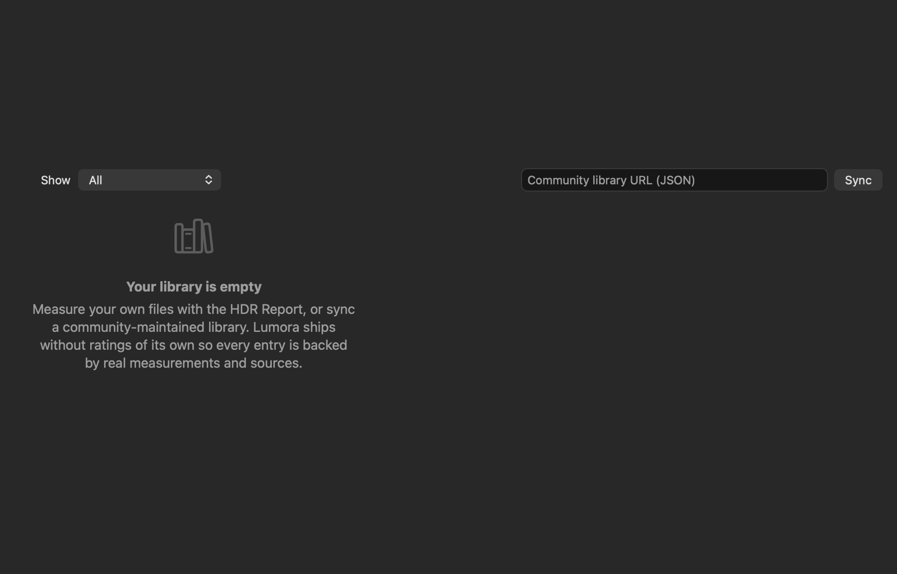 | 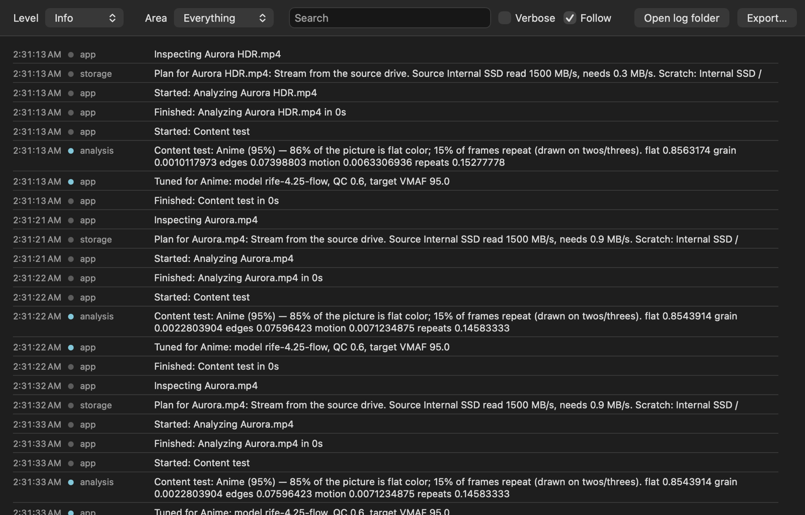 |

- **Compare: original vs interpolated.** Side-by-side or wipe view in HDR, frame stepping with **←/→**, a 0–100
  grade of an interpolated file against its original with a problem-frame list, a model benchmark, and **Repair
  these frames** for a finished export.
- **Model Lab.** Download, import and convert RIFE releases to Core ML (image and HDR-flow variants), benchmark them
  on your footage, see the best model per content type, and install the extra quality metrics.
- **Encode monitor.** Live chunk-by-chunk view of quality-target encodes: state, trials, scores, size.
- **Optimize for this Mac.** Quick (~5 min), Thorough (~30 min) or Burn-in (hours) tuning, with live CPU/GPU/memory/
  thermal gauges.
- **Preview on your TV.** AirPlay picker and player for the 15-second test render.
- **Picture regression set.** Add the current frame with a note; **Check all** re-renders and flags changes.
- **UHD HDR library.** Your own and community HDR title measurements; add Report Card results.
- **Log.** Every event, filterable, exportable. Error alerts have a **Show log** button that opens it.

---

## Settings

**Lumora → Settings… (⌘,)** has three tabs:

| Storage | Tools | Runs & Library |
|---|---|---|
| 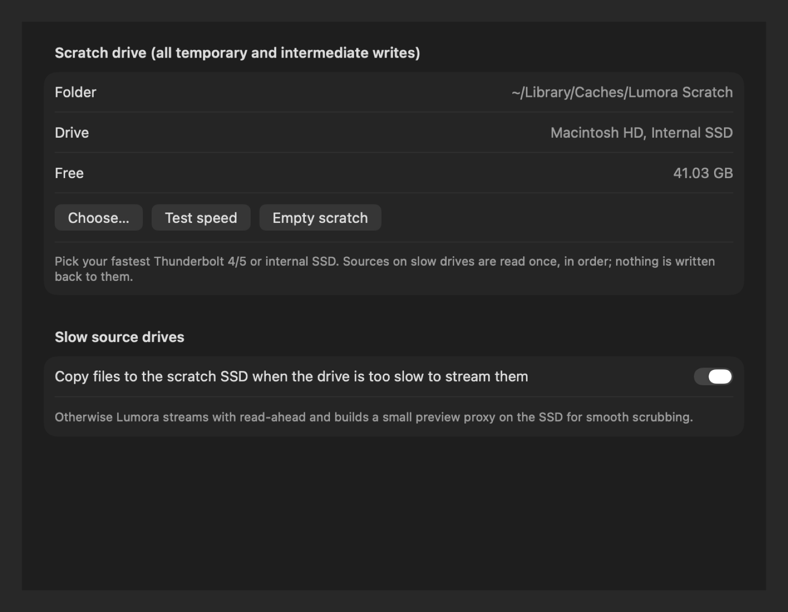 | 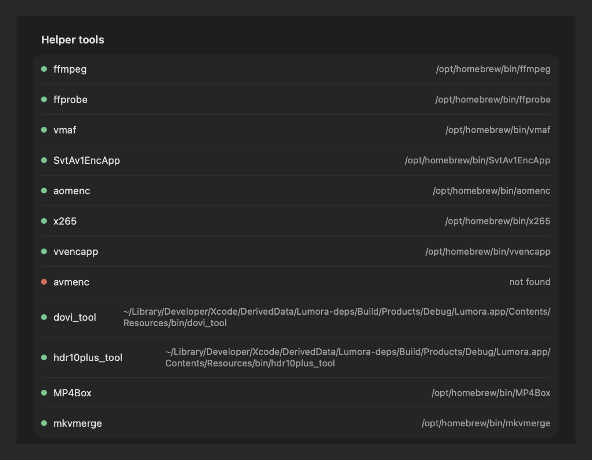 | 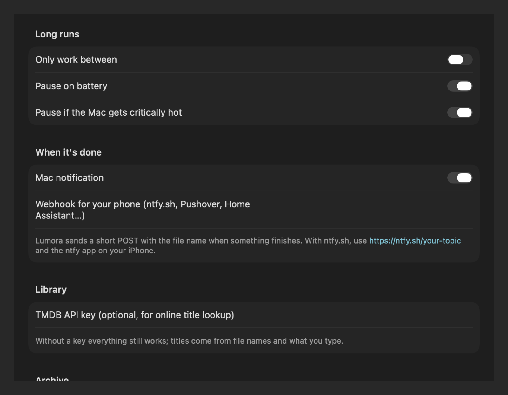 |


- **Storage**
  - **Scratch drive:** where every temporary and intermediate file goes. **Choose…** your fastest SSD, **Test
    speed**, **Empty scratch**.
  - **Slow source drives:** copy files to the scratch SSD when a drive is too slow to stream them; otherwise Lumora
    streams with read-ahead and builds a preview proxy.
- **Tools**
  - **Helper tools:** which encoders and tools were found, and where.
  - **VMAF:** whether quality measurement is available, and how.
- **Runs & Library**
  - **Long runs:** only work between set hours, pause on battery, pause if the Mac gets critically hot, and resume
    an unfinished batch.
  - **When it's done:** Mac notification, and a webhook (ntfy.sh, Pushover, Home Assistant…) to reach your phone.
  - **Library:** optional TMDB API key for online title lookup. Without one, titles come from file names.
  - **Archive:** verify an archive folder against its checksums.

The **Optimize for this Mac** window has its own **Forget profile** button to discard its measurements.

---

## Keyboard shortcuts

| Keys | Action |
|---|---|
| **⌘O** | Open a file |
| **⌘E** | Export |
| **⌘,** | Settings |
| **Space** | Play / pause (Simple mode) |
| **← / →** | Previous / next frame (main window and Compare) |
| **Return** | Confirm the default button in sheets |

---

## Where Lumora keeps things

| What | Where |
|---|---|
| Temporary and intermediate files | Your scratch drive; by default `~/Library/Caches/Lumora Scratch/` |
| Interpolation and upscaling models | `~/Library/Application Support/Lumora/Models/` |
| Model Lab environment | `~/Library/Application Support/Lumora/ModelLab/` |
| Mac optimization profile, learning data, batch queue | `~/Library/Application Support/Lumora/` |
| Logs | `~/Library/Logs/Lumora/lumora-YYYY-MM-DD.log` |

Full list, including every settings key: [Command-line guide](command-line.md#files-and-folders).

---

## Recipes

**Make an HDR10 version of an SDR video for your TV.** Simple mode → *Watch it on my TV* → Export.

**Shrink a UHD Blu-ray rip without visible loss.** Simple mode → *Archive it* (or *Make it much smaller*) → keep the
quality target on → Export. Use AV1 if your player supports it, HEVC Dolby Vision 8.1 to keep the original Dolby
Vision.

**Interpolate an HDR film without changing its look.** Pro mode → look **Keep original look** → Motion → frame rate
→ Deliver → HDR10, HEVC 10-bit / AV1 / ProRes 4444 XQ 12-bit → Export. For full 12-bit precision, install the RIFE
HDR-flow model ([Command-line guide](command-line.md#converting-interpolation-models)).

**Fix a dim HDR rip.** Tools → HDR report to confirm it's dim → pick **Rip Revive** → export HDR10 or Dolby Vision
8.1.

**Turn an iPhone Apple Log clip into a graded HDR clip.** Open it → compare the Apple Log / Apple Log 2 looks →
pick one → Deliver → HLG or Dolby Vision 8.4 for Apple devices → Export.

**Make a LUT for another app.** Pick a look → Tools → LUT → Export .cube, 65 points.
